# Sestante

[](LICENSE)


Scegli un riquadro di Terra. Sestante ne legge la ripresa satellitare, la ricostruisce in 3D e ti ci fa camminare dentro in prima persona, con la borsa di strumenti di un ricercatore sul campo e un registro che si scrive da solo.

Non è un visore di mappe: è un banco di lavoro. Ogni altezza dichiara da dove viene, ogni volume ha il suo intervallo d'errore, e dove uno strumento non può rispondere lo dice.

> **In English.** Sestante turns any box of satellite imagery into a walkable 3D world and a field research bench: dated shots, shadow-derived heights checked against NASA's GEDI laser, national LiDAR, least-cost ancient routes, volume measurement, photo geolocation from the skyline, and hypothesis files with exportable reports. It runs locally on Node and three.js, works without API keys, and states the error of what it measures. The interface and documentation are in Italian.

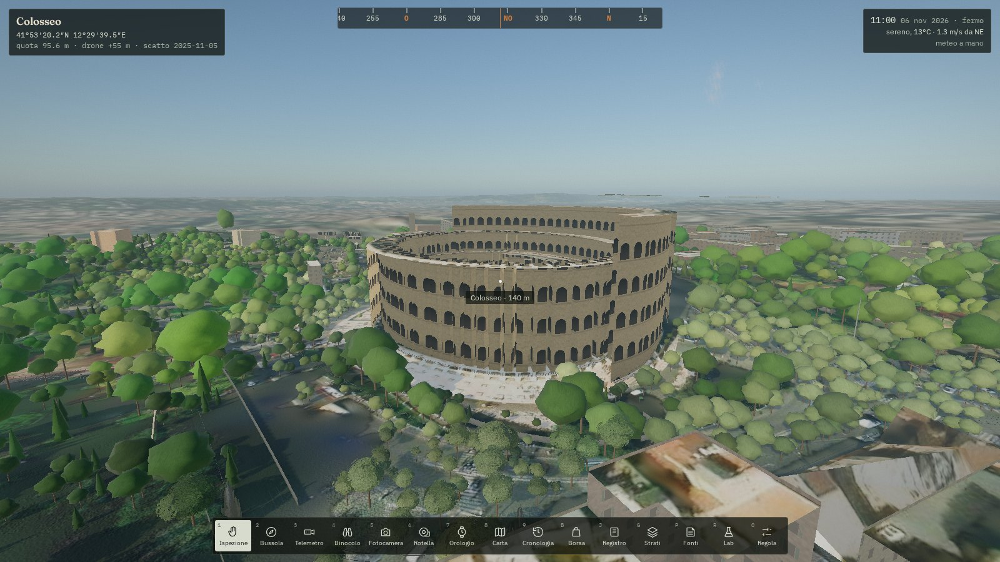

## Indice

- [Schermate](#schermate)
- [Requisiti](#requisiti)
- [Installazione](#installazione)
- [Servizio di sistema su Debian](#servizio-di-sistema-su-debian)
- [Chiavi personali](#chiavi-personali)
- [Il percorso](#il-percorso)
- [La ricerca sul campo](#la-ricerca-sul-campo)
- [Comandi sul campo](#comandi-sul-campo)
- [Come si ricostruisce il mondo](#come-si-ricostruisce-il-mondo)
- [Collaudi su valori noti](#collaudi-su-valori-noti)
- [Struttura e sviluppo](#struttura)
- [Limiti noti](#limiti-noti)
- [Fonti e licenze](#fonti-e-licenze)

## Schermate

| | |
| --- | --- |
| 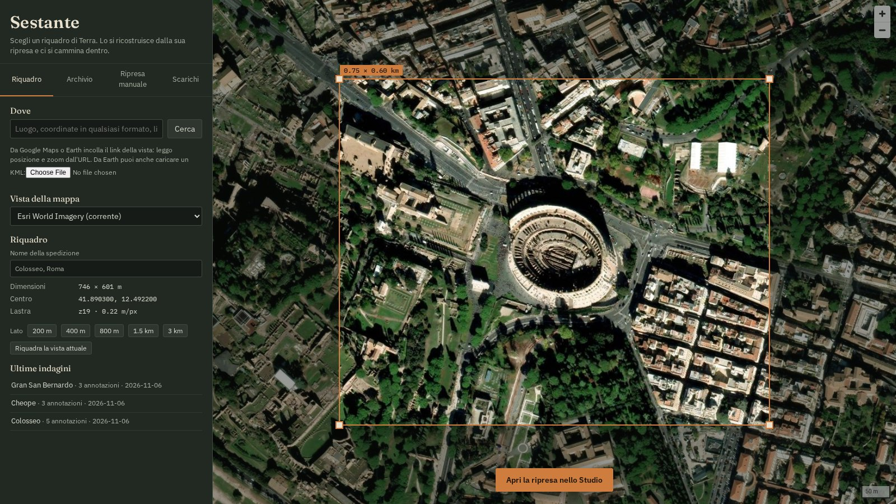 **Atlante.** Un luogo, un punto in qualunque formato o un link di mappa diventano il riquadro. | 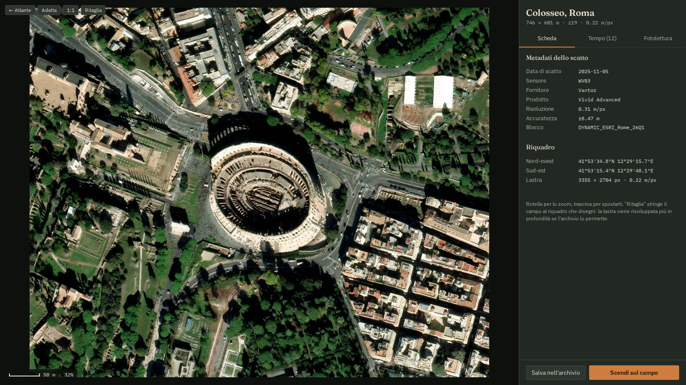 **Studio.** La lastra con i metadati veri dello scatto e tutte le riprese distinte di quel punto. |
| 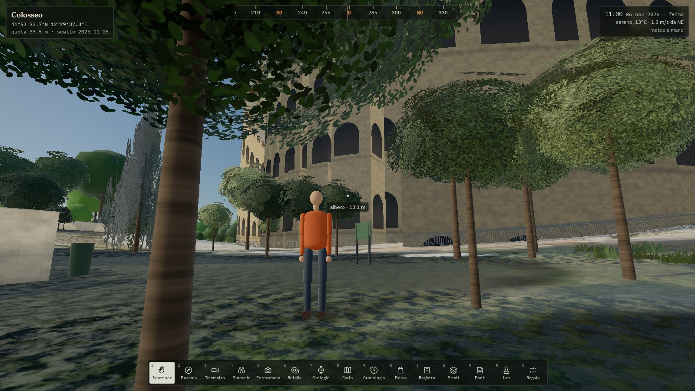 **Alter-ego.** Il tuo corpo in misure reali, come metro per la scala di ciò che hai davanti. | 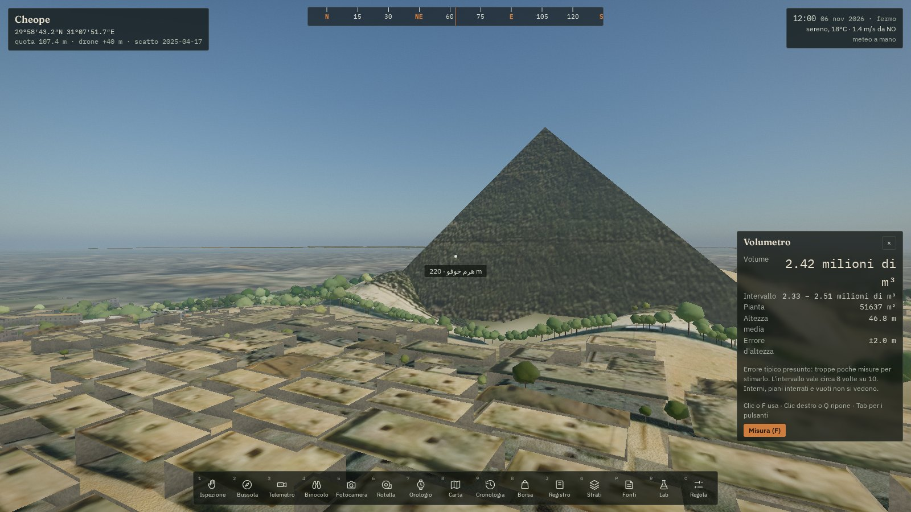 **Volumetro.** La piramide di Cheope: 2,42 milioni di m³ con il loro intervallo, contro 2,45 geometrici. |
| 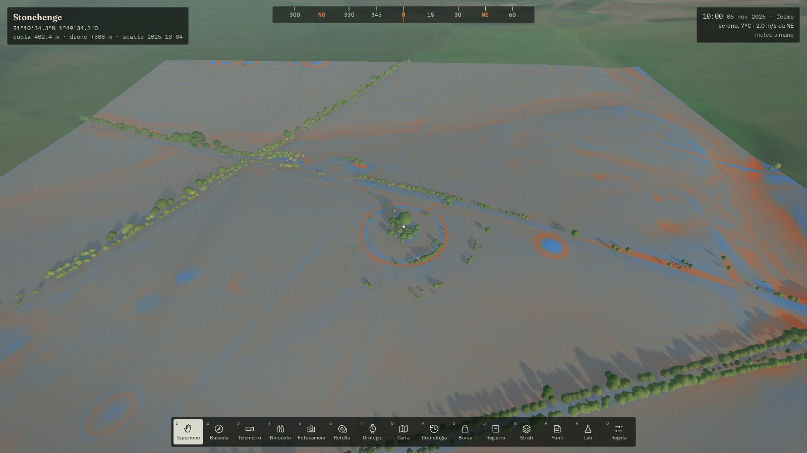 **LiDAR nazionale.** Stonehenge nel rilievo locale: il fossato e i tumuli che sulla foto si vedono appena. | 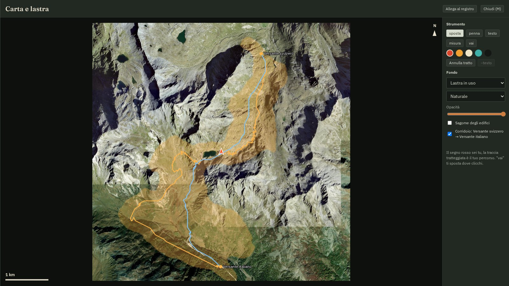 **Vie antiche.** Il Gran San Bernardo: due vie di minor fatica e il corridoio delle alternative. |
| 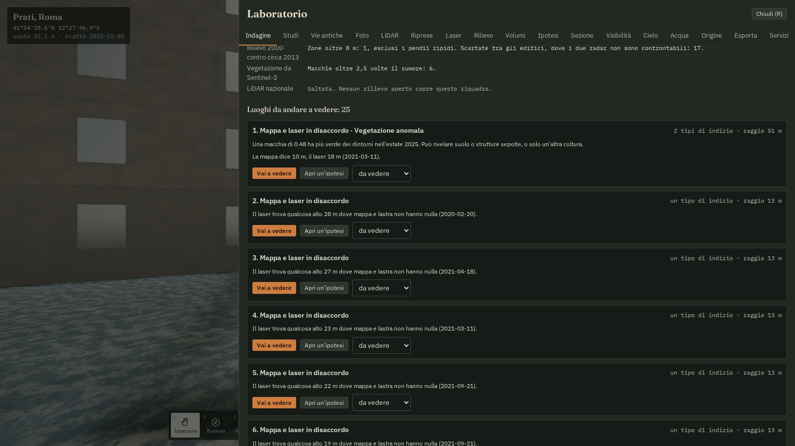 **Indagine.** "Cosa c'è di strano qui?": luoghi da visitare da indizi indipendenti, con le fonti saltate. | 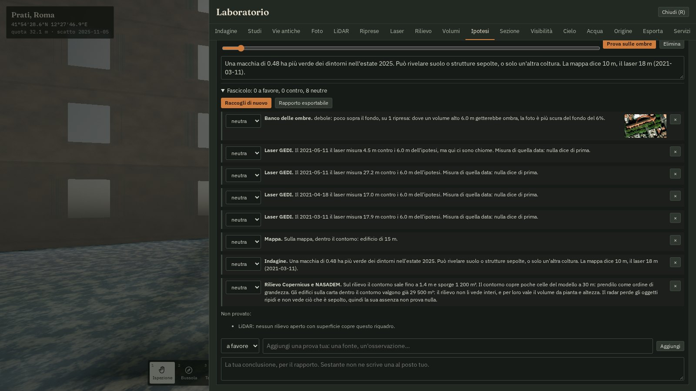 **Fascicolo.** Prove a favore, contro e neutre di un'ipotesi, con rapporto esportabile. |
| 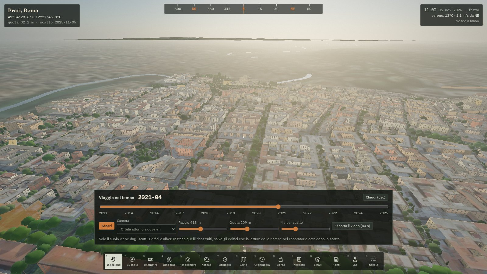 **Viaggio nel tempo.** Un cursore fra gli scatti dal 2011 al 2025, con la camera in orbita, esportabile in video. | 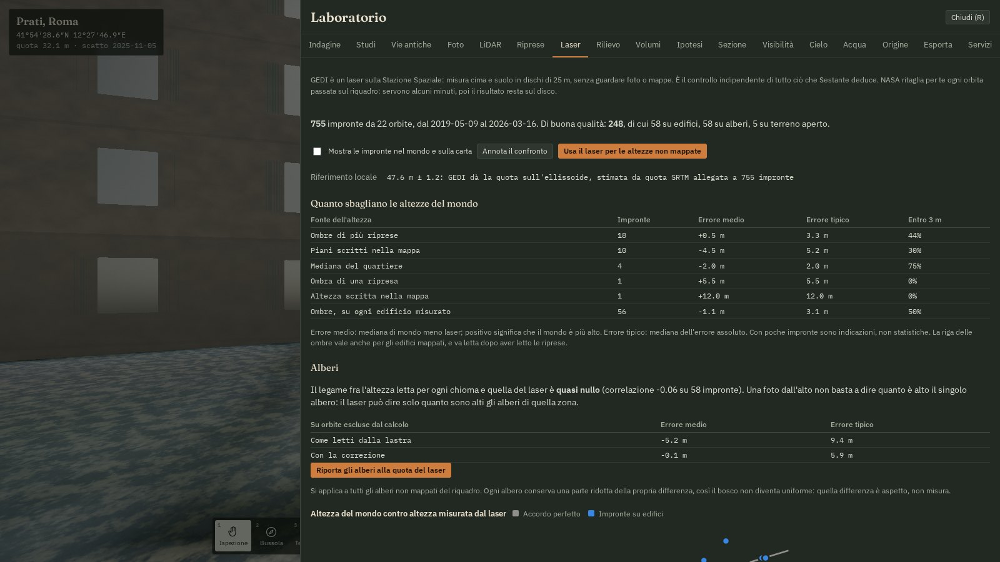 **Laser GEDI.** Quanto sbaglia ogni fonte di altezza, misurato da un laser sulla Stazione Spaziale. |
| 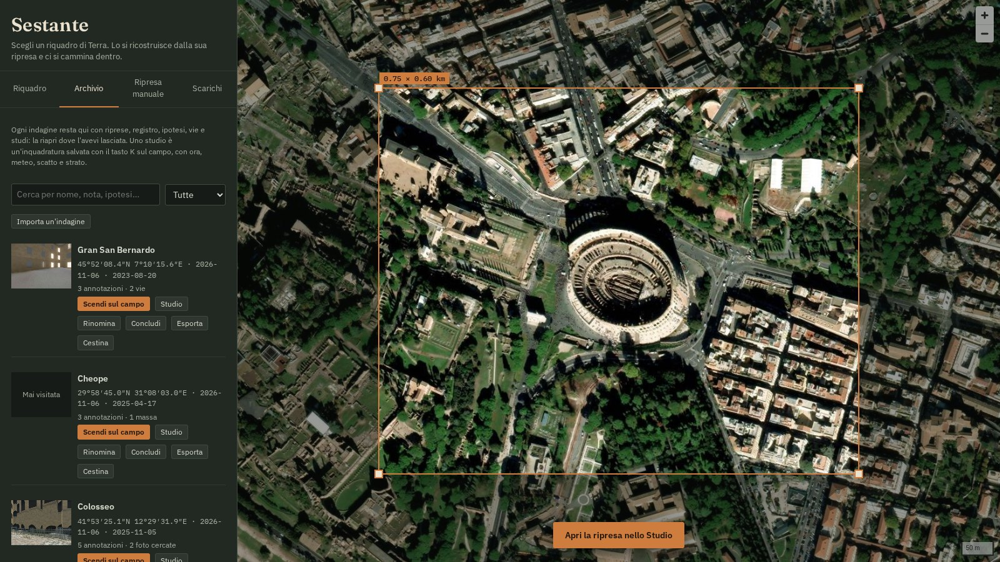 **Archivio.** Ogni indagine, con i suoi studi, ricerca nel testo, cestino ed esportazione. | |

Immagini di sfondo nelle schermate: Esri, Maxar, Earthstar Geographics e la comunità degli utenti GIS, tramite Esri World Imagery e Wayback. Dati degli edifici © OpenStreetMap contributors. Rilievo laser di Stonehenge: Environment Agency, Open Government Licence.

## Requisiti

- **Node 24** o più recente. Il server usa `node:sqlite` e il TypeScript nativo di Node, senza passaggi di compilazione. Test e server girano sia su Node 24 sia su Node 26; il collaudo completo nel motore è stato fatto su Node 26.
- **Un browser con WebGL2** e l'accelerazione grafica attiva: Firefox o Chromium. La grafica gira tutta nel browser, quindi il server non ha bisogno di una GPU.
- **La rete**, per tessere e dati. Ciò che è già stato visto resta in cache.
- Circa 500 MB per il progetto con le sue dipendenze, più la cache, che cresce con i luoghi visitati.

Sviluppato e provato su Debian 13 con una RTX 3060 e driver Nouveau, in Chromium con Vulkan. In Firefox è stata provata la camminata, non ogni strumento.

## Installazione

```bash
git clone https://github.com/Indr1d-C0ld/sestante.git
cd sestante
npm ci
npm run build
npm start
```

Poi apri http://localhost:4173. Senza chiavi funziona già tutto ciò che usa fonti libere: la sezione [Chiavi personali](#chiavi-personali) dice cosa si aggiunge con quelle gratuite.

| Comando | Cosa fa |
| --- | --- |
| `npm start` | Server di produzione sulla porta 4173, con la build in `dist/` |
| `npm run dev` | Sviluppo con Vite e ricarica a caldo (usa anche la porta successiva) |
| `npm test` | I 101 test, su scene sintetiche di cui si conosce la verità |
| `npm run typecheck` | Controllo dei tipi |

Variabili d'ambiente: `PORT` per la porta, `SESTANTE_DATA` per la cartella dei dati (predefinita `data/` nel progetto). Il server ascolta solo su `127.0.0.1`.

## Servizio di sistema su Debian

Queste istruzioni installano Sestante come servizio `systemd` con un utente dedicato: codice in `/opt/sestante`, dati in `/var/lib/sestante`, chiavi in `/etc/sestante`. L'unità è in [`deploy/sestante.service`](deploy/sestante.service).

**Attenzione: Sestante non ha autenticazione.** Chiunque raggiunga la porta può leggere, modificare e cestinare le indagini. Per questo ascolta solo su `127.0.0.1`: non esporla in rete così com'è, e leggi [Accesso da un altro computer](#accesso-da-un-altro-computer).

### 1. Node

Il pacchetto `nodejs` di Debian è in genere troppo vecchio (controlla con `apt-cache policy nodejs`). Il pacchetto ufficiale si installa così in `/usr/local`, dove l'unità si aspetta di trovarlo:

```bash
sudo apt install git curl xz-utils ca-certificates
```

```bash
NODE_TAR=$(curl -fsSL https://nodejs.org/dist/latest-v26.x/ | grep -o 'node-v26[0-9.]*-linux-x64.tar.xz' | head -1)
```

```bash
curl -fsSLO "https://nodejs.org/dist/latest-v26.x/$NODE_TAR"
```

```bash
sudo tar -xJf "$NODE_TAR" -C /usr/local --strip-components=1 --exclude=CHANGELOG.md --exclude=LICENSE --exclude=README.md
```

```bash
node --version
```

Su ARM a 64 bit sostituisci `linux-x64` con `linux-arm64`.

### 2. Utente e codice

L'utente del servizio non ha shell né permessi sul codice: il codice appartiene a te e lui lo legge soltanto.

```bash
sudo useradd --system --home-dir /var/lib/sestante --shell /usr/sbin/nologin sestante
```

```bash
sudo install -d -o "$USER" -g "$USER" /opt/sestante
```

```bash
git clone https://github.com/Indr1d-C0ld/sestante.git /opt/sestante
```

```bash
cd /opt/sestante && npm ci && npm run build && npm prune --omit=dev
```

### 3. Chiavi, facoltative

Il file è leggibile solo da root e dal servizio. Lascia vuote le chiavi che non hai.

```bash
sudo install -d -m 750 -o root -g sestante /etc/sestante
```

```bash
sudo install -m 640 -o root -g sestante /opt/sestante/.env.example /etc/sestante/sestante.env
```

```bash
sudoedit /etc/sestante/sestante.env
```

### 4. Il servizio

```bash
sudo install -m 644 /opt/sestante/deploy/sestante.service /etc/systemd/system/sestante.service
```

```bash
sudo systemctl daemon-reload
```

```bash
sudo systemctl enable --now sestante
```

Per controllare che risponda e leggere i messaggi:

```bash
systemctl status sestante
```

```bash
curl -sI http://127.0.0.1:4173 | head -1
```

```bash
journalctl -u sestante -f
```

La cartella `/var/lib/sestante` la crea `systemd` al primo avvio, con il proprietario giusto.

### Cambiare la porta o le opzioni

```bash
sudo systemctl edit sestante
```

Nel file che si apre:

```ini
[Service]
Environment=PORT=8080
```

Poi `sudo systemctl restart sestante`. L'unità è irrigidita: `ProtectSystem=strict`, `ProtectHome`, nessuna capability, scrittura solo nella cartella di stato. `MemoryDenyWriteExecute` resta spento perché il JIT di Node e WebAssembly ne hanno bisogno. Per misurarne l'esposizione: `systemd-analyze security sestante`.

### Aggiornare

```bash
cd /opt/sestante && git pull && npm ci && npm run build && npm prune --omit=dev
```

```bash
sudo systemctl restart sestante
```

### Accesso da un altro computer

La strada più semplice e sicura è un tunnel SSH, lanciato dal computer con il browser. Poi apri http://localhost:4173 come se fosse locale:

```bash
ssh -N -L 4173:127.0.0.1:4173 utente@server
```

Per un accesso stabile serve un proxy inverso con HTTPS e password. Questo esempio per nginx è solo un punto di partenza, e non è stato provato con Sestante:

```nginx
server {
    listen 443 ssl;
    server_name sestante.esempio.it;
    ssl_certificate     /etc/letsencrypt/live/sestante.esempio.it/fullchain.pem;
    ssl_certificate_key /etc/letsencrypt/live/sestante.esempio.it/privkey.pem;

    auth_basic           "Sestante";
    auth_basic_user_file /etc/nginx/sestante.htpasswd;

    # Fotografie e pacchetti delle indagini passano da qui, e alcuni dati impiegano minuti.
    client_max_body_size 500m;
    proxy_read_timeout   600s;

    location / {
        proxy_pass http://127.0.0.1:4173;
        proxy_set_header Host $host;
    }
}
```

Le chiavi restano comunque sul server, ma ogni visitatore autenticato le usa e consuma le tue quote.

### Salvataggi e disinstallazione

In `/var/lib/sestante` conta `expeditions/`, con indagini, foto e video, e `cestino/`, dove finisce ciò che cestini dall'Archivio finché non lo svuoti a mano. La cartella `cache/` si può cancellare a servizio fermo e si ricostruisce da sola, ma dati come i ritagli GEDI richiedono minuti per tornare.

```bash
sudo tar -czf sestante-indagini.tar.gz -C /var/lib/sestante expeditions cestino
```

Per togliere il servizio, lasciando i dati:

```bash
sudo systemctl disable --now sestante
```

```bash
sudo rm /etc/systemd/system/sestante.service
```

## Chiavi personali

Sestante funziona anche senza chiavi. Con queste, tutte gratuite, ha qualcosa in più. Copia [`.env.example`](.env.example) in `.env` nella cartella del progetto, oppure in `/etc/sestante/sestante.env` col servizio di sistema:

```ini
COPERNICUS_CLIENT_ID=...       # Sentinel-1 e 2 su misura, serie NDVI, firma spettrale
COPERNICUS_CLIENT_SECRET=...
NASA_FIRMS_MAP_KEY=...         # fuochi attivi e archivio dal 2000
OPENWEATHER_API_KEY=...        # seconda stazione, aria, previsioni, carte meteo
NASA_EARTHDATA_TOKEN=...       # laser GEDI e rilievo NASADEM: scade dopo 60 giorni
```

Le legge solo il server: non arrivano mai al browser, non finiscono nei salvataggi e vengono cancellate dai messaggi di errore. Lo stato di ciascuna è in Laboratorio → Servizi.

## Il percorso

1. **Atlante.** Cerca un luogo, scrivi un punto o incolla un link di una mappa, carica un KML di Google Earth. Trascina il riquadro. Un punto diventa il centro esatto della ripresa, segnato anche nello Studio e sul campo con un picchetto. Vengono riconosciuti da soli: gradi decimali anche con la virgola, gradi e primi, gradi primi e secondi in ogni grafia, emisferi N S E O W anche prima dei numeri, formato compatto `415324N 0122932E`, UTM, MGRS, Plus Code, Geohash, Maidenhead, GeoJSON, WKT, KML, `geo:` e i link di Google Maps, OpenStreetMap, Bing, Apple Maps, Yandex, HERE e Wikipedia. La scheda dice che formato ha letto e quanto è preciso il dato: `41.89, 12.49` vale ±557 m. Il limite reale resta la ripresa: la sua accuratezza è nei metadati, e il satellite riprende di sbieco, quindi la cima di un edificio alto appare spostata rispetto alla sua base.
2. **Studio.** Zoom e pan sulla lastra, ritaglio, metadati veri dello scatto (data, sensore, risoluzione, accuratezza), tutte le riprese distinte di quel punto, confronto a tenda, alternato o per differenze, filtri da fotointerprete.
3. **Campo.** Cammini. Il tempo è reale 1:1 e il meteo è quello attuale di default; tutto si cambia dalle impostazioni.

## La ricerca sul campo

**Strati della Terra (G).** Immagini Sentinel-2 per data, in colore vero e negli indici NDVI, NDWI, NBR e BSI, radar Sentinel-1, mosaici Landsat dal 1983 al 2000, luci notturne. Tutto si stende sul suolo e sulla carta. Ci sono anche la fenologia del riquadro, le anomalie della vegetazione per cercare segni nelle colture, i fuochi NASA FIRMS, due stazioni meteo a confronto, l'aria, le previsioni e le carte storiche georiferite con punti di controllo, che riportano l'errore in metri.

**Fonti del luogo (P).** Foto Panoramax e Wikimedia Commons scattate nel riquadro, dalla più vicina, e voci di Wikipedia. Puoi metterti dove fu presa una foto, sovrapporla alla vista o proiettarla sul mondo.

**Laboratorio (R).**

| Scheda | Cosa fa |
| --- | --- |
| Riprese | Legge tutti gli scatti insieme: altezze da più soli con margine d'errore, edifici datati fra due riprese, disaccordi fra mappa e ombre |
| Laser | Impronte GEDI sul riquadro, ritagliate da NASA: misura quanto sbaglia ogni fonte di altezza e può fissare quelle non mappate |
| Rilievo | Differenza fra NASADEM (2000) e Copernicus (circa 2011–2015): cosa è cresciuto o scomparso a grana di 30 m |
| Indagine | "Cosa c'è di strano qui?": luoghi da visitare da indizi indipendenti |
| Studi | Inquadrature salvate con ora, meteo, scatto e strato |
| Vie antiche | Percorsi di minor fatica, corridoi, visibilità fra siti |
| Foto | Dove è stata scattata una foto, dall'orizzonte e dalle ombre |
| LiDAR | Rilievi laser nazionali aperti: suolo, tracce, altezze |
| Volumi | Cubatura del riquadro per fonte, strutture più voluminose, masse tracciate sul terreno, verifica degli intervalli col laser |
| Ipotesi | Banco delle ombre: disegna un volume, calcola la sua ombra in ogni ripresa e la confronta con il terreno intorno |
| Sezione | Profilo di suolo e costruito lungo un tracciato |
| Visibilità | Che cosa si vede da qui, con rilievo, edifici, curvatura e rifrazione |
| Cielo | Solstizi, equinozi e lunistizi in ogni epoca, con l'orizzonte reale, e confronto con l'asse di un edificio |
| Acqua | Una lastra d'acqua a una quota scelta, con area e volume |
| Origine | Colora il mondo secondo la provenienza delle altezze: mappata, letta dalle ombre, presunta |
| Esporta | Modello GLB per Blender e altri motori, GeoJSON per QGIS, DXF per il CAD, CSV |
| Servizi | Stato delle chiavi e cosa c'è negli archivi NASA sul riquadro |

**Quanto ci si può fidare delle altezze.** GEDI è un laser sulla Stazione Spaziale e non guarda né foto né mappe, quindi è un controllo indipendente. A Prati, a Roma, in un riquadro di 1,2 km con 755 impronte, di cui 248 di buona qualità:

| Fonte dell'altezza | Impronte | Errore medio | Errore tipico |
| --- | --- | --- | --- |
| Ombre di più riprese | 42 | −0,7 m | 2,9 m |
| Ombra di una sola ripresa (lettura precedente) | 21 | −2,6 m | 5,0 m |
| Piani scritti nella mappa × 3,2 m | 10 | −4,5 m | 5,2 m |

I gruppi di edifici non sono identici e il campione è piccolo: sono ordini di grandezza, non una statistica. GEDI riporta le quote sull'ellissoide: il riferimento locale si ricava dalla quota SRTM allegata alle impronte, perché il terreno di Sestante, sotto un parco, poggia sulle chiome. Il laser ha i suoi limiti: il disco è di 25 m, e la cima può venire da un vicino. Sul solo riquadro del Colosseo le impronte buone su edifici sono appena 10. Ogni riquadro calcola la propria tabella nel Laboratorio. Anche gli edifici possono cambiare fra la data del laser e quella della lastra.

**Gli alberi.** L'altezza letta per ogni singola chioma, con o senza ombra, risulta quasi slegata da quella del laser: correlazione fra −0,06 e +0,09 nei tre luoghi provati. Una foto dall'alto non basta. Il laser però dice quanto sono alti gli alberi di una zona, quindi la correzione porta ogni gruppo alla quota misurata e lascia a ciascun albero solo una variazione ridotta, che è aspetto e non misura. Viene scelta e verificata per ogni riquadro lasciando fuori intere orbite, e si propone solo se l'errore scende almeno del 10%:

| Luogo | Impronte | Letti dalla lastra | Con la correzione |
| --- | --- | --- | --- |
| Prati, quartiere denso | 58 | errore tipico 9,4 m, medio −5,2 m | 5,9 m, −0,1 m |
| Colosseo, area mista | 27 | 7,0 m, +3,6 m | 5,3 m, −0,8 m |
| Villa Borghese, parco | 184 | 4,8 m, −0,7 m | 3,9 m, −0,1 m |

Un fattore unico valido per ogni luogo è stato provato e scartato: peggiora su due luoghi su tre. Le altezze scritte sulla mappa non vengono toccate, e la scheda dell'albero mostra anche il valore letto dalla lastra.

**I volumi.** Il Volumetro nella borsa misura ciò che inquadri, e anche la scheda di ogni edificio (E) riporta il volume. Sono volumi esterni, sempre con un intervallo pensato per valere circa 8 volte su 10:

| Oggetto | Come | Limite |
| --- | --- | --- |
| Edificio | Pianta meno cortili, per altezza, più la forma del tetto. L'errore d'altezza è quello misurato col laser sul riquadro, o a Prati | Niente interni né interrati |
| Struttura a più parti | Ogni colonna conta solo la parte più alta, così le sovrapposizioni non pesano due volte | Come sopra |
| Massa sul terreno | F traccia il contorno. Copernicus meno il suolo ricostruito dal bordo, controllato su NASADEM | Celle da 30 m; conta tetti e chiome; il sepolto non si vede; il radar non segue le pareti ripide: Cheope risulta 0,7–1,5 milioni di m³ invece di 2,4, e il volumetro avvisa quando i modelli non concordano |
| Chioma | Forma presunta | Solo ordine di grandezza |

Collaudo su oggetti con un valore noto: Cheope da pianta e altezza 2,42 milioni di m³ (2,33–2,51) contro 2,45 geometrici, Monte Testaccio dal rilievo 458 600 m³ (225 700–523 600) contro circa 580 000 pubblicati, quindi sotto il vero e fuori dall'intervallo. Le altezze cadono dentro l'intervallo per 48 impronte laser su 54 (Prati 32 su 34, Borghese 10 su 11, Colosseo 6 su 9); a Prati il controllo è in parte circolare, perché gli errori vengono dalle stesse impronte.

**L'indagine.** Il Laboratorio, nella scheda Indagine, chiede "Cosa c'è di strano qui?": unisce scatti che cambiano, edifici comparsi, ombre senza edificio, disaccordi col laser, rilievo cambiato, vegetazione anomala e tracce nel LiDAR. Ne esce un elenco di luoghi da visitare, segnati nel mondo e sulla carta, con le fonti usate e quelle saltate. L'ordine dice da dove cominciare, non che lì ci sia qualcosa.

**Il fascicolo.** Ogni ipotesi raccoglie dagli strumenti le prove a favore, contro e neutre, più quelle aggiunte a mano. Il conto non diventa una probabilità, e il rapporto HTML autonomo riporta anche ciò che non si è potuto provare.

**Le vie antiche.** Dati due siti, calcola il percorso di minor fatica sul rilievo, a piedi con la funzione di Tobler o con un carico, con i fiumi da guadare o invalicabili. Mostra il corridoio delle alternative quasi equivalenti e chi vede chi fra i siti. Al collaudo sul Gran San Bernardo la via supera la cresta a 58 m dal valico a piedi e a 29 m col carro. Il rilievo è quello di oggi, e il risultato è un'ipotesi.

**Il viaggio nel tempo.** Dalla cronologia degli scatti, un cursore continuo fra le date, con la camera in orbita, ferma o attraverso gli studi salvati. Si esporta come video con data e scala. Solo il suolo viene dagli scatti.

**LiDAR nazionali.** Dove esistono e sono aperti: suolo ombreggiato, rilievo locale, altezze degli edifici e terreno del mondo a circa un metro.

| Rilievo | Paese | Risoluzione | Superficie con edifici |
| --- | --- | --- | --- |
| AHN | Paesi Bassi | 0,5 m | Sì |
| IGN LiDAR HD | Francia, dove già volato | 1 m | Sì |
| Environment Agency | Inghilterra | 1 m | Sì |
| swissALTI3D e swissSURFACE3D | Svizzera | 0,5 m | Sì |
| DHM Vlaanderen II | Fiandre | 1 m | Sì |
| DGM1 NRW | Renania Settentrionale-Vestfalia | 1 m | No |
| NMT GUGiK | Polonia | 1 m | No |
| USGS 3DEP | Stati Uniti | Fino a 1 m | No |

In Italia il portale nazionale permette di scaricare solo il modello a 20 m: l'1 m si può soltanto guardare.

**Dove è questa foto.** Carichi una foto con il profilo del paesaggio: la linea del cielo si legge da sola, si corregge a mano e si confronta da ogni punto dell'area con il rilievo, per obiettivi diversi. Le ombre di un oggetto verticale danno il Sole, e da lì l'ora o le date possibili. È una pista: su foto reali di Zermatt il punto migliore è caduto da 0,5 a 2,7 km dal vero, con esito sempre "ambiguo".

**L'alter-ego.** Un corpo con altezza, spalle e corporatura vere, che fissa occhi e falcata. Lo guardi da fuori con X, e lo strumento Alter-ego confronta tutto con te e ne lascia copie accanto agli oggetti.

**L'archivio.** Dalla pagina iniziale ritrovi ogni indagine con miniatura, ricerca nel testo, stato e cestino, e la esporti come pacchetto con le foto dentro. Una ripresa si salva dallo Studio senza scendere. Il tasto K salva uno studio: posizione, sguardo, ora, meteo, scatto e strato. Tutti tornano con un clic.

**Strumenti nuovi nella borsa.** Alter-ego, Volumetro, laser spaziale GEDI, stazione topografica con errore di chiusura, ipotesi di volume, sezione, spettroradiometro (sette bande reali di Sentinel-2), campionatore d'aria, allarme termico, astrolabio. La fotocamera aggiunge la **lunga posa** (bordi risolti e penombre vere) e lo **studio della luce**, un tracciamento di cammini su una copia semplificata del luogo: rimbalzi e ombre sono calcolati, ma facciate, erba e nuvole non ci sono.

## Comandi sul campo

| Tasto | Azione |
| --- | --- |
| WASD, Maiusc, Spazio, C | Cammina, corri, salta, accovacciati |
| Clic o F | Usa lo strumento in mano: la lettura va nel registro |
| Clic destro o Q | Ripone lo strumento e chiude la scheda; col drone in volo lo fa atterrare |
| Tab | Libera il cursore per i pulsanti senza fermarti: continui a camminare |
| E | Apre e chiude la scheda dell'oggetto inquadrato. V la annota. Allontanandoti si chiude da sola |
| 1–9 o rotella | Strumenti rapidi; lo stesso tasto li ripone. B apre tutta la borsa |
| J, M, T, O | Registro, carta, cronologia degli scatti, impostazioni |
| G, P, R | Strati della Terra, fonti del luogo, laboratorio |
| L, H, N | Torcia, nascondi il quadrante, vista nadirale del drone |
| X, K | Guardati da fuori, salva uno studio |
| Rotella | Ingrandimento di binocolo, monocolo e obiettivo |
| Esc | Chiude il pannello e torna a camminare; altrimenti mette in pausa |

## Come si ricostruisce il mondo

Ogni numero dichiara la sua fonte. La scheda di un edificio dice se l'altezza è mappata, dedotta dai piani, letta dall'ombra o solo tipica.

| Cosa | Da dove |
| --- | --- |
| Colore del suolo e dei tetti | La lastra stessa, con le ombre incise rimosse per lasciar posto a quelle vere |
| Rilievo | Terrarium (SRTM e altri), Copernicus GLO-30 o NASADEM, a scelta nelle impostazioni; lisciato di più dove è costruito, perché entrambi misurano anche i tetti |
| Edifici | OSM: sagome, cortili, parti, forme del tetto, materiali. Co-registrati sulla lastra |
| Sole dello scatto | Direzione delle ombre attorno agli edifici più data di acquisizione: ne esce l'istante dello scatto |
| Altezze mancanti | Lunghezza dell'ombra × tangente del sole, tarata sugli edifici di altezza nota. Con tutte le riprese lette: mediana pesata fra più date, con margine d'errore. Un'altezza scritta sulla mappa non viene mai sovrascritta |
| Alberi | Chiome individuate sulla lastra, altezza dall'ombra, colore dal pixel; alberi OSM con specie dove esistono |
| Edifici non mappati | Tetto compatto con la propria ombra, solo se nessun edificio mappato spiega quell'ombra |
| Acqua | Poligoni OSM, più le aree grandi, lisce, piatte sul DEM e bluastre |
| Passato | Ogni scatto Wayback rilegge suolo, tetti, alberi e corpi dedotti. Dopo aver letto le riprese, gli edifici risultati assenti in quello scatto spariscono |

## Collaudi su valori noti

Ogni strumento è stato provato dove la risposta esiste già. I test automatici usano scene sintetiche di cui si conosce la verità; questi collaudi usano il mondo vero, e i risultati brutti restano scritti.

| Strumento | Caso | Risultato |
| --- | --- | --- |
| Altezze dalle ombre, più date | GEDI a Prati, Roma | Errore tipico 2,9 m, tendenza −0,7 m, su 42 impronte |
| Altezze dai piani OSM | GEDI a Prati | Errore tipico 5,2 m, tendenza −4,5 m, su 10 impronte |
| Altezza di una singola chioma | GEDI, tre zone di Roma | Correlazione circa zero: una foto dall'alto non la dà. Corretta per gruppi: da 9,4 a 5,9 m a Prati, su orbite escluse |
| Intervallo delle altezze | GEDI, tre zone di Roma | 48 impronte su 54 dentro l'intervallo |
| Volume da pianta e altezza | Piramide di Cheope | 2,42 milioni di m³ (2,33–2,51) contro 2,45 geometrici |
| Massa dal rilievo | Monte Testaccio | 458 600 m³ (225 700–523 600) contro circa 580 000 pubblicati: sotto il vero e fuori dall'intervallo |
| Massa dal rilievo | Piramide di Cheope | Da 0,73 a 1,53 milioni di m³ contro 2,45: il radar non segue le pareti ripide, e lo strumento avvisa |
| Vie di minor fatica | Gran San Bernardo | La via supera la cresta a 58 m dal valico a piedi, a 29 m col carro. Gli estremi sono stati scelti ai due lati della cresta |
| Posizioni nei LiDAR | Cervino, Domtoren, Torre Eiffel, Salisbury, Berna, Bruges, Rysy, Langenberg | Vetta o torre entro circa 25 m dal riferimento. USGS 3DEP non verificato: il servizio era giù |
| Altezze dal LiDAR | Domtoren di Utrecht, guglia di Salisbury | 106,8 m su 112,3 e 100,3 m su 123: le guglie sottili risultano basse |
| Foto da localizzare | Foto simulate | Ritrovate con la direzione e l'obiettivo giusti |
| Foto da localizzare | Foto reali di Zermatt | Il punto migliore cade da 0,5 a 2,7 km dal vero in un'area di 3 km, oltre 7 km in due foto su tre su 20 km. Esito sempre "ambiguo": è una pista, non una localizzazione |
| Foto da localizzare | Interno del Colosseo | "Ambiguo" o "impossibile", come deve |

Le altre chiavi di lettura sono nel codice: `tests/` contiene le scene sintetiche, e ogni scheda del Laboratorio mostra su quante misure si regge ciò che dice.

## MapTilesDownloader

La scheda **Scarichi** dell'Atlante riprende le funzioni di [MapTilesDownloader](https://github.com/AliFlux/MapTilesDownloader) (MIT), riscritte in Node: riquadro, fonte, zoom, MBTiles, cartella `z/x/y`, mosaico PNG con world file e fonti personali con `{x} {y} {z} {quad}`. Gli output finiscono in `data/downloads`, ognuno con un `provenienza.json`.

La vecchia fonte Carto ora richiede una chiave: è stata sostituita con Esri grigio chiaro. Non sono preimpostati Google e Bing: i loro termini vietano lo scarico fuori dalle API ufficiali. Il campo per le fonti personali accetta qualunque modello; la responsabilità di rispettarne i termini è di chi lo aggiunge. OpenStreetMap è limitato a 250 tessere per lavoro come chiede la sua policy.

## Fonti e licenze

AHN, IGN LiDAR HD, Environment Agency, swisstopo, Digitaal Vlaanderen, Geobasis NRW, GUGiK e USGS 3DEP per i rilievi laser. Esri World Imagery e Wayback, Sentinel-2 cloudless di EOX, OpenStreetMap (ODbL), Mapzen Terrain Tiles su AWS, Open-Meteo, Nominatim, Copernicus Sentinel e Copernicus DEM (ESA), NASA GIBS, CMR, FIRMS, Harmony, GEDI e NASADEM (LP DAAC), Element 84 Earth Search, OpenWeather, Panoramax, Wikimedia Commons e Wikipedia (le foto e i testi mantengono autore e licenza, mostrati accanto). Ogni fonte mantiene i propri termini d'uso: sono pensate per un uso personale e di ricerca, non per la ridistribuzione.

## Struttura

```
server/       proxy e cache tessere, Wayback, OSM, meteo, dati della Terra, NASA, chiavi, scarichi, salvataggi
src/core/     geodesia, sole e luna, archeoastronomia, rilievo, API, tipi
src/vision/   fotolettura della lastra, lettura multi-data, banco delle ombre (codice puro) e filtri
src/atlas/    Atlante, Studio, ripresa manuale
src/field/    caricamento del campo, strumenti, laboratorio, indagine, fascicolo, vie, viaggio nel tempo, foto
src/world/    motore: terreno, edifici, vegetazione, cielo, nuvole, post-processing, collisioni, audio
tests/        scene sintetiche di cui si conosce la verità, formule meteo e geodetiche
deploy/       unità systemd
docs/         schermate
data/         cache, indagini, scarichi e cestino (creata al primo avvio, non versionata)
```

Tecnologie: Node con TypeScript nativo e `node:sqlite` sul server; React 19, MapLibre e Vite nell'Atlante; un motore proprio su three.js r187 e WebGL2 sul campo, con ombre a cascate, cielo e nuvole volumetriche, post-processing e collisioni; `three-gpu-pathtracer` per lo studio della luce; `geotiff`, `h5wasm` e `sharp` per i dati; `proj4` per le proiezioni nazionali.

## Limiti noti

- Non c'è autenticazione: il server ascolta solo su `127.0.0.1`, e per aprirlo in rete serve un proxy con password.
- Non esistono interni: gli edifici si vedono da fuori e si sale sui tetti, non si entra.
- Le facciate sono procedurali, non fotografate. Il satellite vede solo i tetti. La foto proiettata le copre solo vicino al punto di scatto e non calcola chi nasconde cosa: persone e auto finiscono stese a terra, e l'allineamento va ritoccato a mano.
- Automobili e persone restano dipinte nella lastra.
- Il suolo oltre il riquadro è un mosaico a bassa risoluzione, senza edifici.
- Dove SRTM ha già registrato una struttura massiccia, come le piramidi di Giza, il rilievo e l'edificio mappato si sovrappongono.
- Le altezze lette dalle ombre risentono dell'inclinazione del satellite e di ciò su cui cade l'ombra: sono stime, e la scheda ne riporta l'attendibilità.
- La datazione degli edifici può sbagliare con alberi e cantieri, e sul Colosseo non esiste una verità di confronto: ogni voce riporta la certezza e va controllata a occhio. Gli scatti con la sola data di pubblicazione non contribuiscono.
- Il banco delle ombre si confonde dove altri edifici o alberi proiettano ombra sulla stessa zona.
- Le anomalie della vegetazione lavorano a 10 m per pixel: mostrano solo tracce grandi, e la causa va verificata.
- GEDI passa a strisce: un riquadro piccolo può ricevere poche impronte o nessuna, e solo un terzo circa è di buona qualità in città. Non copre oltre 51,6° di latitudine.
- ICESat-2 e gli altri prodotti NASA del catalogo vengono solo elencati.
- Le guglie sottili risultano basse nel LiDAR: la Domtoren misura 106,8 m su 112,3, Salisbury 100,3 su 123. Le tracce del rilievo locale includono filari, fossi e opere moderne, e vanno guardate.
- La ricerca della foto copre al massimo il riquadro più 10 km, e le nuvole a volte ingannano la linea del cielo.
- Nel viaggio nel tempo cambia solo il suolo: edifici e alberi restano quelli ricostruiti, salvo gli edifici datati dalla lettura delle riprese.
- Gli alberi restano la lettura più debole: anche corretti, l'errore tipico è di 4–6 m, e l'altezza del singolo albero non è nota. Il laser misura la cima più alta in un disco di 25 m, quindi la correzione poggia su quella.
- Sulla macchina di sviluppo NVK non espone ray tracing: lo studio della luce gira nel frammento WebGL2.

## Licenza

Sestante è software libero, distribuito secondo i termini della [GNU General Public License versione 3](LICENSE). Copyright © 2026 Indrid Cold.

La licenza copre il codice, non i dati: le immagini satellitari, le mappe e i modelli che Sestante scarica restano dei rispettivi proprietari, con i termini elencati in [Fonti e licenze](#fonti-e-licenze). Anche le dipendenze mantengono le proprie licenze, tutte compatibili con la GPLv3.
