# Sestante

[](LICENSE)


Scegli un riquadro di Terra. Sestante ne legge la ripresa satellitare, la ricostruisce in 3D e ti ci fa camminare dentro in prima persona, con la borsa di strumenti di un ricercatore sul campo e un registro che si scrive da solo.

Non è un visore di mappe: è un banco di lavoro. Ogni altezza dichiara da dove viene, ogni volume ha il suo intervallo d'errore, e dove uno strumento non può rispondere lo dice.

> **In English.** Sestante turns any box of satellite imagery into a walkable 3D world and a field research bench: dated shots, shadow-derived heights checked against NASA's GEDI laser, national LiDAR, least-cost ancient routes, volume measurement, photo geolocation from the skyline, and hypothesis files with exportable reports. It runs locally on Node and three.js, works without API keys, and states the error of what it measures. The interface and documentation are in Italian.

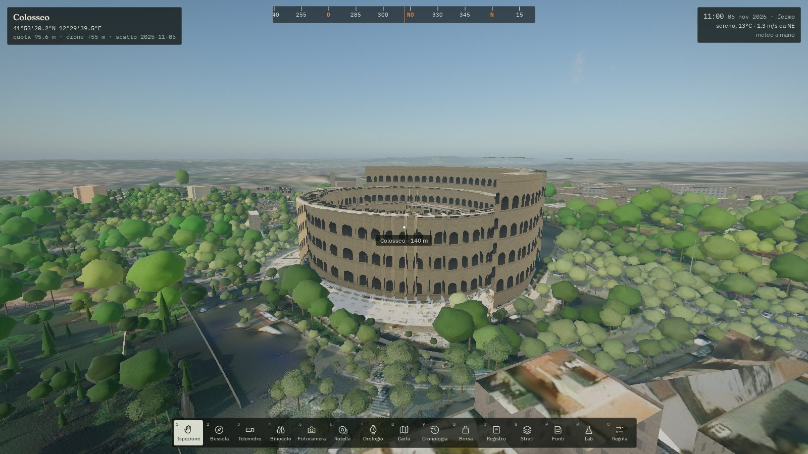

## Indice

- [Schermate](#schermate)
- [Requisiti](#requisiti)
- [Installazione](#installazione)
- [Servizio di sistema su Debian](#servizio-di-sistema-su-debian)
- [Chiavi personali](#chiavi-personali)
- [Il percorso](#il-percorso)
- [La ricerca sul campo](#la-ricerca-sul-campo)
- [Comandi sul campo](#comandi-sul-campo)
- [Come si ricostruisce il mondo](#come-si-ricostruisce-il-mondo)
- [Collaudi su valori noti](#collaudi-su-valori-noti)
- [Struttura e sviluppo](#struttura)
- [Limiti noti](#limiti-noti)
- [Fonti e licenze](#fonti-e-licenze)

## Schermate

| | |
| --- | --- |
| 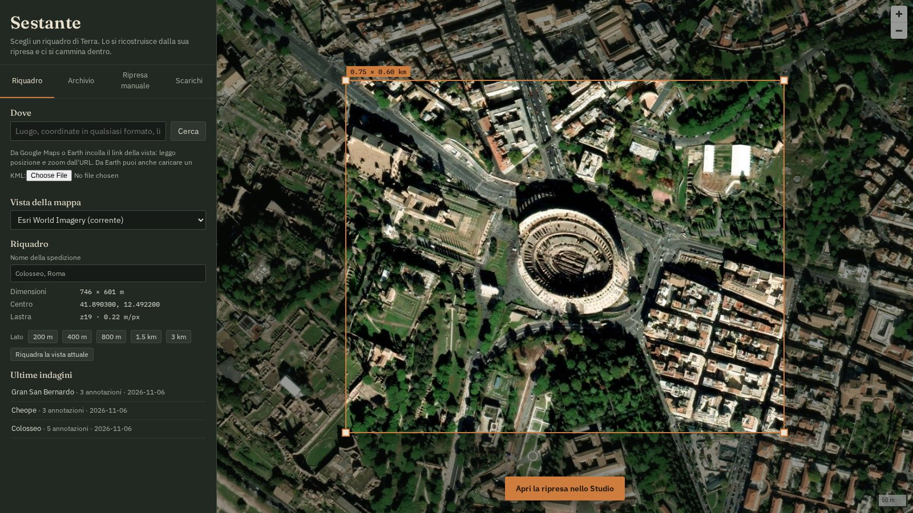 **Atlante.** Un luogo, un punto in qualunque formato o un link di mappa diventano il riquadro. | 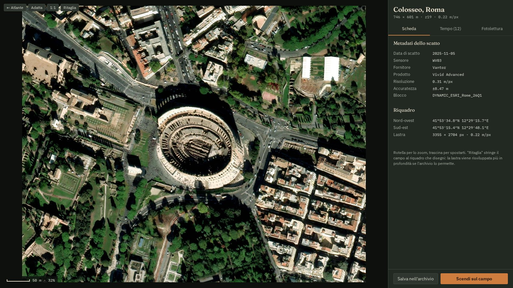 **Studio.** La lastra con i metadati veri dello scatto e tutte le riprese distinte di quel punto. |
| 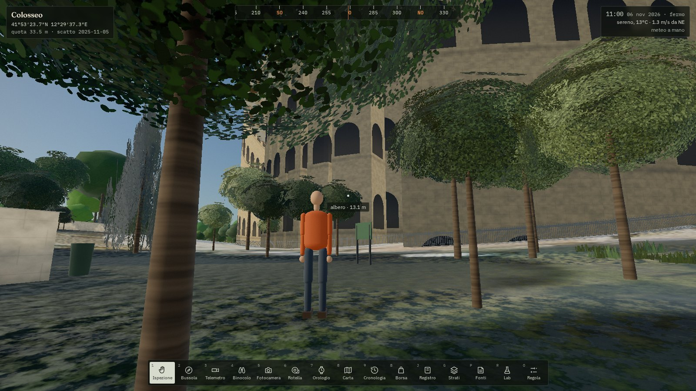 **Alter-ego.** Il tuo corpo in misure reali, come metro per la scala di ciò che hai davanti. | 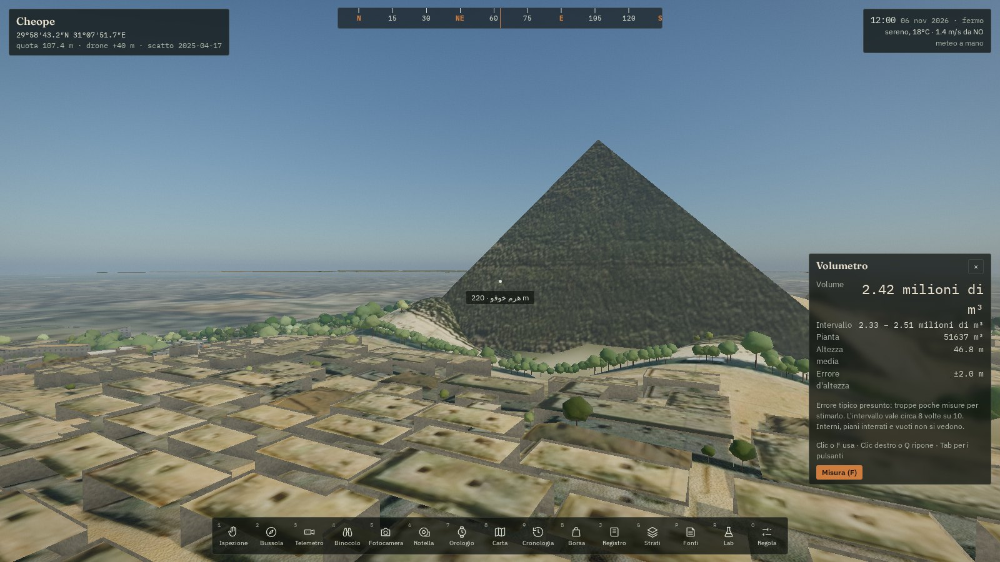 **Volumetro.** La piramide di Cheope: 2,42 milioni di m³ con il loro intervallo, contro 2,45 geometrici. |
| 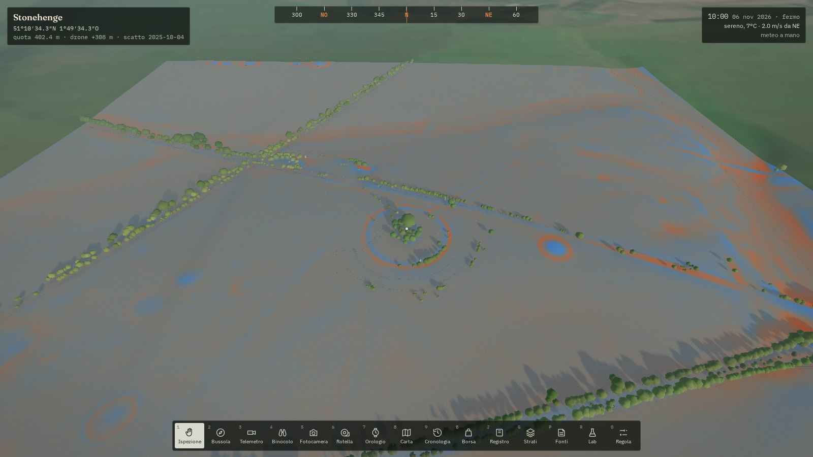 **LiDAR nazionale.** Stonehenge nel rilievo locale: il fossato e i tumuli che sulla foto si vedono appena. | 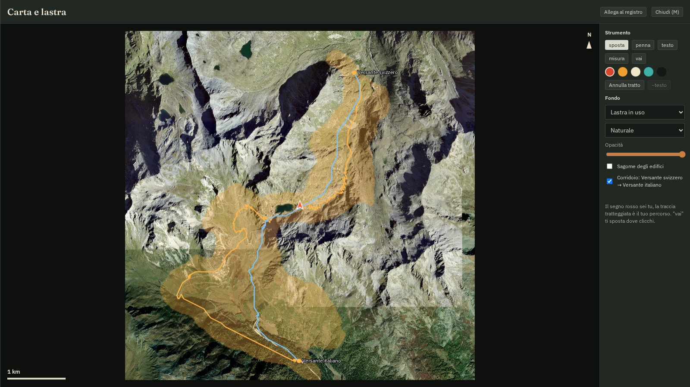 **Vie antiche.** Il Gran San Bernardo: due vie di minor fatica e il corridoio delle alternative. |
| 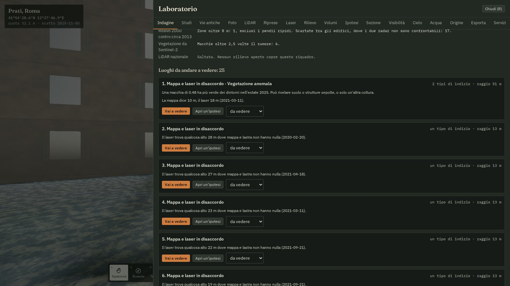 **Indagine.** "Cosa c'è di strano qui?": luoghi da visitare da indizi indipendenti, con le fonti saltate. | 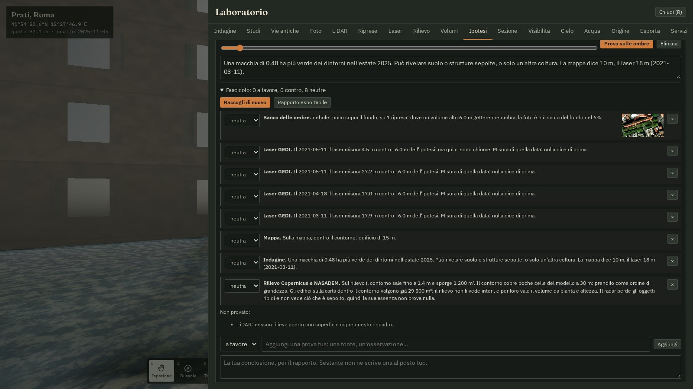 **Fascicolo.** Prove a favore, contro e neutre di un'ipotesi, con rapporto esportabile. |
| 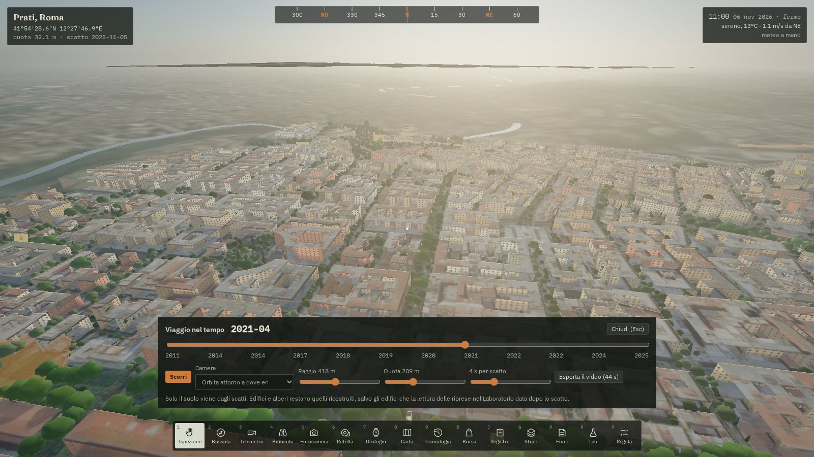 **Viaggio nel tempo.** Un cursore fra gli scatti dal 2011 al 2025, con la camera in orbita, esportabile in video. | 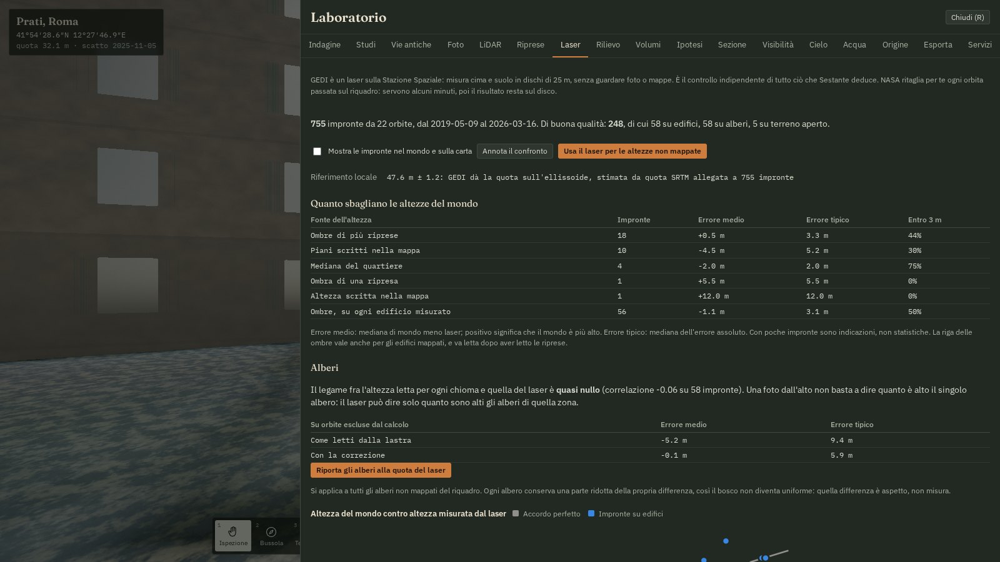 **Laser GEDI.** Quanto sbaglia ogni fonte di altezza, misurato da un laser sulla Stazione Spaziale. |
| 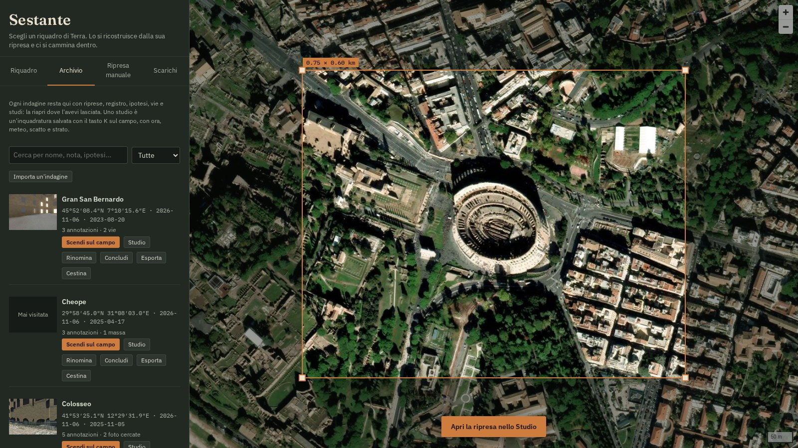 **Archivio.** Ogni indagine, con i suoi studi, ricerca nel testo, cestino ed esportazione. | 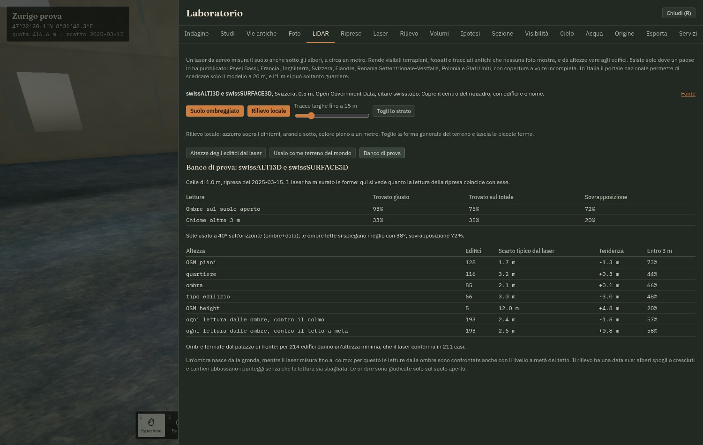 **Banco di prova.** Zurigo: ombre, chiome e altezze lette dalla ripresa, confrontate col LiDAR nazionale fonte per fonte. |

Immagini di sfondo nelle schermate: Esri, Maxar, Earthstar Geographics e la comunità degli utenti GIS, tramite Esri World Imagery e Wayback. Dati degli edifici © OpenStreetMap contributors. Rilievo laser di Stonehenge: Environment Agency, Open Government Licence.

## Requisiti

- **Node 24** o più recente. Il server usa `node:sqlite` e il TypeScript nativo di Node, senza passaggi di compilazione. Test e server girano sia su Node 24 sia su Node 26; il collaudo completo nel motore è stato fatto su Node 26.
- **Un browser con WebGL2** e l'accelerazione grafica attiva: Firefox o Chromium. La grafica gira tutta nel browser, quindi il server non ha bisogno di una GPU.
- **La rete**, per tessere e dati. Ciò che è già stato visto resta in cache.
- Circa 500 MB per il progetto con le sue dipendenze, più la cache, che cresce con i luoghi visitati.

Sviluppato e provato su Debian 13 con una RTX 3060 e driver Nouveau, in Chromium con Vulkan. In Firefox è stata provata la camminata, non ogni strumento.

## Installazione

```bash
git clone https://github.com/Indr1d-C0ld/Sestante.git
cd Sestante
npm ci
npm run build
npm start
```

Poi apri http://localhost:4173. Senza chiavi funziona già tutto ciò che usa fonti libere: la sezione [Chiavi personali](#chiavi-personali) dice cosa si aggiunge con quelle gratuite.

| Comando | Cosa fa |
| --- | --- |
| `npm start` | Server di produzione sulla porta 4173, con la build in `dist/` |
| `npm run dev` | Sviluppo con Vite e ricarica a caldo (usa anche la porta successiva) |
| `npm test` | I 122 test, su scene sintetiche di cui si conosce la verità |
| `npm run typecheck` | Controllo dei tipi |

Variabili d'ambiente: `PORT` per la porta, `SESTANTE_DATA` per la cartella dei dati (predefinita `data/` nel progetto). Il server ascolta solo su `127.0.0.1`.

### Motore WebGPU, sperimentale

Accanto al motore WebGL2 sta nascendo un motore WebGPU, scelto in **Regola → Motore grafico → Renderer** e attivo dal prossimo ingresso nel campo; per una sola visita basta aggiungere `&motore=webgpu` all'indirizzo. Dove il browser non offre WebGPU lo stesso motore disegna tramite WebGL2, e la stessa scheda dice quale dei due sta lavorando e perché.

- **Firefox:** WebGPU è spento per impostazione predefinita. Si accende in `about:config` con `dom.webgpu.enabled` a `true`; così Firefox ESR 153 su Linux disegna il motore sulla scheda grafica (provato su una RTX 3060 col driver NVIDIA).
- **Chromium:** va avviato con `--enable-unsafe-webgpu --enable-features=Vulkan,WebGPU`.

Cosa è portato: terreno, tetti e campo lontano leggono la ripresa come nel motore WebGL2, e da vicino il suolo ha la sua grana (asfalto, lastre, terra, prato) e le sue piccole asperità; i muri hanno le stesse cinque facciate con finestre e luci di notte; le chiome hanno foglie e ondeggiano nel vento, i tronchi hanno corteccia; l'erba prende il colore del prato sottostante e si piega; l'acqua si muove; muretti, ringhiere, strade e arredi ci sono. Il sole getta ombre a cascata, il cielo fisico di three.js illumina la scena anche come ambiente, e dopo la scena vengono occlusione ambientale (GTAO), bagliore e la prospettiva aerea del motore WebGL2: il colore del cielo lungo ogni linea di vista, che si scalda verso il sole, e l'estinzione dalla visibilità riportata, assottigliata con la quota.

Cosa manca: nuvole, pioggia, neve, allagamento, proiezione delle foto e colori della provenienza. Differenze ancora visibili: il chiarore verso il sole è più debole, perché il cielo di three.js è meno caldo di quello proprio, e il prato da vicino è più chiaro e meno verde. La scheda del motore elenca cosa è portato e cosa no. L'aspetto è stato tarato a occhio contro il motore WebGL2 sul riquadro di Zurigo.

**Prestazioni.** Il motore WebGPU è limitato dal processore, non dalla scheda: three.js spende di più per ogni disegno su WebGPU. Il profilo del processore indicava un terzo del tempo alle ombre a cascata e un quinto al bagliore di three.js, una dozzina di passaggi di sfocatura. Per questo:

- la cascata d'ombra vicina si ridisegna a ogni fotogramma, la seconda ogni due e la terza ogni quattro; in volo non si nota;
- il bagliore è una sola sfocatura larga a un quarto della risoluzione, e con l'impostazione a zero non viene eseguito;
- gli edifici sono un unico blocco invece di uno per ogni quadrato di 260 m: da 71 a 47 oggetti da disegnare.

Su una RTX 3060, a 1400×820, con la versione installata e senza il limite dello schermo, nelle stesse condizioni, un fotogramma di Zurigo dura 2,2 ms col motore WebGL2. Col motore WebGPU dura 3,4 ms (prima di queste modifiche 5,25). Il divario è sceso da 2,4 a circa 1,5 volte. I valori assoluti cambiano col carico della macchina, quindi vanno confrontati solo dentro la stessa serie. Il motore WebGL2 resta il predefinito finché quello nuovo non lo eguaglia su misure e schermate.

### Segmentazione con rete neurale, facoltativa

Sestante può far leggere la ripresa anche a FLAIR-INC, una rete dell'IGN francese che distingue edifici, asfalto, terra, acqua, conifere, latifoglie, arbusti ed erba. Senza, tutto funziona con le regole proprie. Servono due cose:

1. `onnxruntime-node`, che `npm ci` installa come dipendenza facoltativa (circa 570 MB). Usa la scheda grafica tramite WebGPU, se c'è, altrimenti il processore: circa 1 s per ripresa su una RTX 3060, 5 s sul processore.
2. Il modello in `data/models/flair-rgb15.onnx` (98 MB): `npm run modello` lo scarica dalla release [modello-flair-rgb15-v1](https://github.com/Indr1d-C0ld/Sestante/releases/tag/modello-flair-rgb15-v1) e ne verifica l'impronta. È il file dell'IGN convertito da PyTorch a ONNX, con i pesi invariati. Chi preferisce convertirlo da sé trova i comandi in [tools/flair-to-onnx.py](tools/flair-to-onnx.py): servono Python e PyTorch per il solo processore (circa 1 GB, fuori dal progetto), e il file dell'IGN viene aperto in modo che legga solo numeri, senza eseguire codice.

```bash
npm run modello
```

`GET /api/landcover/status` dice se il modello è pronto e, se no, perché. La prima nota di ogni indagine dice se la rete è stata usata.

## Servizio di sistema su Debian

Queste istruzioni installano Sestante come servizio `systemd` con un utente dedicato: codice in `/opt/sestante`, dati in `/var/lib/sestante`, chiavi in `/etc/sestante`. L'unità è in [`deploy/sestante.service`](deploy/sestante.service).

**Attenzione: Sestante non ha autenticazione.** Chiunque raggiunga la porta può leggere, modificare e cestinare le indagini. Per questo ascolta solo su `127.0.0.1`: non esporla in rete così com'è, e leggi [Accesso da un altro computer](#accesso-da-un-altro-computer).

### 1. Node

Il pacchetto `nodejs` di Debian è in genere troppo vecchio (controlla con `apt-cache policy nodejs`). Il pacchetto ufficiale si installa così in `/usr/local`, dove l'unità si aspetta di trovarlo:

```bash
sudo apt install git curl xz-utils ca-certificates
```

```bash
NODE_TAR=$(curl -fsSL https://nodejs.org/dist/latest-v26.x/ | grep -o 'node-v26[0-9.]*-linux-x64.tar.xz' | head -1)
```

```bash
curl -fsSLO "https://nodejs.org/dist/latest-v26.x/$NODE_TAR"
```

```bash
sudo tar -xJf "$NODE_TAR" -C /usr/local --strip-components=1 --exclude=CHANGELOG.md --exclude=LICENSE --exclude=README.md
```

```bash
node --version
```

Su ARM a 64 bit sostituisci `linux-x64` con `linux-arm64`.

### 2. Utente e codice

L'utente del servizio non ha shell né permessi sul codice: il codice appartiene a te e lui lo legge soltanto.

```bash
sudo useradd --system --home-dir /var/lib/sestante --shell /usr/sbin/nologin sestante
```

```bash
sudo install -d -o "$USER" -g "$USER" /opt/sestante
```

```bash
git clone https://github.com/Indr1d-C0ld/Sestante.git /opt/sestante
```

```bash
cd /opt/sestante && npm ci && npm run build && npm prune --omit=dev
```

### 3. Chiavi, facoltative

Il file è leggibile solo da root e dal servizio. Lascia vuote le chiavi che non hai.

```bash
sudo install -d -m 750 -o root -g sestante /etc/sestante
```

```bash
sudo install -m 640 -o root -g sestante /opt/sestante/.env.example /etc/sestante/sestante.env
```

```bash
sudoedit /etc/sestante/sestante.env
```

### 4. Il servizio

```bash
sudo install -m 644 /opt/sestante/deploy/sestante.service /etc/systemd/system/sestante.service
```

```bash
sudo systemctl daemon-reload
```

```bash
sudo systemctl enable --now sestante
```

Per controllare che risponda e leggere i messaggi:

```bash
systemctl status sestante
```

```bash
curl -sI http://127.0.0.1:4173 | head -1
```

```bash
journalctl -u sestante -f
```

La cartella `/var/lib/sestante` la crea `systemd` al primo avvio, con il proprietario giusto.

### Cambiare la porta o le opzioni

```bash
sudo systemctl edit sestante
```

Nel file che si apre:

```ini
[Service]
Environment=PORT=8080
```

Poi `sudo systemctl restart sestante`. L'unità è irrigidita: `ProtectSystem=strict`, `ProtectHome`, nessuna capability, scrittura solo nella cartella di stato. `MemoryDenyWriteExecute` resta spento perché il JIT di Node e WebAssembly ne hanno bisogno. Per misurarne l'esposizione: `systemd-analyze security sestante`.

### Aggiornare

```bash
cd /opt/sestante && git pull && npm ci && npm run build && npm prune --omit=dev
```

```bash
sudo systemctl restart sestante
```

### Accesso da un altro computer

La strada più semplice e sicura è un tunnel SSH, lanciato dal computer con il browser. Poi apri http://localhost:4173 come se fosse locale:

```bash
ssh -N -L 4173:127.0.0.1:4173 utente@server
```

Per un accesso stabile serve un proxy inverso con HTTPS e password. Questo esempio per nginx è solo un punto di partenza, e non è stato provato con Sestante:

```nginx
server {
    listen 443 ssl;
    server_name sestante.esempio.it;
    ssl_certificate     /etc/letsencrypt/live/sestante.esempio.it/fullchain.pem;
    ssl_certificate_key /etc/letsencrypt/live/sestante.esempio.it/privkey.pem;

    auth_basic           "Sestante";
    auth_basic_user_file /etc/nginx/sestante.htpasswd;

    # Fotografie e pacchetti delle indagini passano da qui, e alcuni dati impiegano minuti.
    client_max_body_size 500m;
    proxy_read_timeout   600s;

    location / {
        proxy_pass http://127.0.0.1:4173;
        proxy_set_header Host $host;
    }
}
```

Le chiavi restano comunque sul server, ma ogni visitatore autenticato le usa e consuma le tue quote.

### Salvataggi e disinstallazione

In `/var/lib/sestante` conta `expeditions/`, con indagini, foto e video, e `cestino/`, dove finisce ciò che cestini dall'Archivio finché non lo svuoti a mano. La cartella `cache/` si può cancellare a servizio fermo e si ricostruisce da sola, ma dati come i ritagli GEDI richiedono minuti per tornare.

```bash
sudo tar -czf sestante-indagini.tar.gz -C /var/lib/sestante expeditions cestino
```

Per togliere il servizio, lasciando i dati:

```bash
sudo systemctl disable --now sestante
```

```bash
sudo rm /etc/systemd/system/sestante.service
```

## Chiavi personali

Sestante funziona anche senza chiavi. Con queste, tutte gratuite, ha qualcosa in più. Copia [`.env.example`](.env.example) in `.env` nella cartella del progetto, oppure in `/etc/sestante/sestante.env` col servizio di sistema:

```ini
COPERNICUS_CLIENT_ID=...       # Sentinel-1 e 2 su misura, serie NDVI, firma spettrale
COPERNICUS_CLIENT_SECRET=...
NASA_FIRMS_MAP_KEY=...         # fuochi attivi e archivio dal 2000
OPENWEATHER_API_KEY=...        # seconda stazione, aria, previsioni, carte meteo
NASA_EARTHDATA_TOKEN=...       # laser GEDI e rilievo NASADEM: scade dopo 60 giorni
```

Le legge solo il server: non arrivano mai al browser, non finiscono nei salvataggi e vengono cancellate dai messaggi di errore. Lo stato di ciascuna è in Laboratorio → Servizi.

## Il percorso

1. **Atlante.** Cerca un luogo, scrivi un punto o incolla un link di una mappa, carica un KML di Google Earth. Trascina il riquadro. Rotella, doppio clic e tasti + e − agiscono sulla mappa anche sopra al riquadro, e quando il riquadro riempie la vista il trascinamento muove la mappa. Un punto diventa il centro esatto della ripresa, segnato anche nello Studio e sul campo con un picchetto. Vengono riconosciuti da soli: gradi decimali anche con la virgola, gradi e primi, gradi primi e secondi in ogni grafia, emisferi N S E O W anche prima dei numeri, formato compatto `415324N 0122932E`, UTM, MGRS, Plus Code, Geohash, Maidenhead, GeoJSON, WKT, KML, `geo:` e i link di Google Maps, OpenStreetMap, Bing, Apple Maps, Yandex, HERE e Wikipedia. La scheda dice che formato ha letto e quanto è preciso il dato: `41.89, 12.49` vale ±557 m. Il limite reale resta la ripresa: la sua accuratezza è nei metadati, e il satellite riprende di sbieco, quindi la cima di un edificio alto appare spostata rispetto alla sua base.
2. **Studio.** Zoom e pan sulla lastra, ritaglio, metadati veri dello scatto (data, sensore, risoluzione, accuratezza), tutte le riprese distinte di quel punto, confronto a tenda, alternato o per differenze, filtri da fotointerprete.
3. **Campo.** Cammini. Il tempo è reale 1:1 e il meteo è quello attuale di default; tutto si cambia dalle impostazioni.

## La ricerca sul campo

**Strati della Terra (G).** Immagini Sentinel-2 per data, in colore vero e negli indici NDVI, NDWI, NBR e BSI, radar Sentinel-1, mosaici Landsat dal 1983 al 2000, luci notturne. Tutto si stende sul suolo e sulla carta. Ci sono anche la fenologia del riquadro, le anomalie della vegetazione per cercare segni nelle colture, i fuochi NASA FIRMS, due stazioni meteo a confronto, l'aria, le previsioni e le carte storiche georiferite con punti di controllo, che riportano l'errore in metri.

**Fonti del luogo (P).** Foto Panoramax e Wikimedia Commons scattate nel riquadro, dalla più vicina, e voci di Wikipedia. Puoi metterti dove fu presa una foto, sovrapporla alla vista o proiettarla sul mondo.

**Laboratorio (R).**

| Scheda | Cosa fa |
| --- | --- |
| Riprese | Legge tutti gli scatti insieme: altezze da più soli con margine d'errore, edifici datati fra due riprese, disaccordi fra mappa e ombre |
| Laser | Impronte GEDI sul riquadro, ritagliate da NASA: misura quanto sbaglia ogni fonte di altezza e può fissare quelle non mappate |
| Rilievo | Differenza fra NASADEM (2000) e Copernicus (circa 2011–2015): cosa è cresciuto o scomparso a grana di 30 m |
| Indagine | "Cosa c'è di strano qui?": luoghi da visitare da indizi indipendenti |
| Studi | Inquadrature salvate con ora, meteo, scatto e strato |
| Vie antiche | Percorsi di minor fatica, corridoi, visibilità fra siti |
| Foto | Dove è stata scattata una foto, dall'orizzonte e dalle ombre |
| LiDAR | Rilievi laser nazionali aperti: suolo, tracce, altezze, e il banco di prova che dà un voto alla ricostruzione |
| Volumi | Cubatura del riquadro per fonte, strutture più voluminose, masse tracciate sul terreno, verifica degli intervalli col laser |
| Ipotesi | Banco delle ombre: disegna un volume, calcola la sua ombra in ogni ripresa e la confronta con il terreno intorno |
| Sezione | Profilo di suolo e costruito lungo un tracciato |
| Visibilità | Che cosa si vede da qui, con rilievo, edifici, curvatura e rifrazione |
| Cielo | Solstizi, equinozi e lunistizi in ogni epoca, con l'orizzonte reale, e confronto con l'asse di un edificio |
| Acqua | Una lastra d'acqua a una quota scelta, con area e volume |
| Origine | Colora il mondo secondo la provenienza delle altezze: mappata, letta dalle ombre, presunta |
| Esporta | Modello GLB per Blender e altri motori, GeoJSON per QGIS, DXF per il CAD, CSV |
| Servizi | Stato delle chiavi e cosa c'è negli archivi NASA sul riquadro |

**Quanto ci si può fidare delle altezze.** GEDI è un laser sulla Stazione Spaziale e non guarda né foto né mappe, quindi è un controllo indipendente. A Prati, a Roma, in un riquadro di 1,2 km con 755 impronte, di cui 248 di buona qualità:

| Fonte dell'altezza | Impronte | Errore medio | Errore tipico |
| --- | --- | --- | --- |
| Ombre di più riprese | 42 | −0,7 m | 2,9 m |
| Ombra di una sola ripresa (lettura precedente) | 21 | −2,6 m | 5,0 m |
| Piani scritti nella mappa × 3,2 m, prima che vi si aggiungessero tetto e basamento | 10 | −4,5 m | 5,2 m |

I gruppi di edifici non sono identici e il campione è piccolo: sono ordini di grandezza, non una statistica. GEDI riporta le quote sull'ellissoide: il riferimento locale si ricava dalla quota SRTM allegata alle impronte, perché il terreno di Sestante, sotto un parco, poggia sulle chiome. Il laser ha i suoi limiti: il disco è di 25 m, e la cima può venire da un vicino. Sul solo riquadro del Colosseo le impronte buone su edifici sono appena 10. Ogni riquadro calcola la propria tabella nel Laboratorio. Anche gli edifici possono cambiare fra la data del laser e quella della lastra.

**Gli alberi.** L'altezza letta per ogni singola chioma, con o senza ombra, risulta quasi slegata da quella del laser: correlazione fra −0,06 e +0,09 nei tre luoghi provati. Una foto dall'alto non basta. Il laser però dice quanto sono alti gli alberi di una zona, quindi la correzione porta ogni gruppo alla quota misurata e lascia a ciascun albero solo una variazione ridotta, che è aspetto e non misura. Viene scelta e verificata per ogni riquadro lasciando fuori intere orbite, e si propone solo se l'errore scende almeno del 10%:

| Luogo | Impronte | Letti dalla lastra | Con la correzione |
| --- | --- | --- | --- |
| Prati, quartiere denso | 58 | errore tipico 9,4 m, medio −5,2 m | 5,9 m, −0,1 m |
| Colosseo, area mista | 27 | 7,0 m, +3,6 m | 5,3 m, −0,8 m |
| Villa Borghese, parco | 184 | 4,8 m, −0,7 m | 3,9 m, −0,1 m |

Un fattore unico valido per ogni luogo è stato provato e scartato: peggiora su due luoghi su tre. Le altezze scritte sulla mappa non vengono toccate, e la scheda dell'albero mostra anche il valore letto dalla lastra.

**I volumi.** Il Volumetro nella borsa misura ciò che inquadri, e anche la scheda di ogni edificio (E) riporta il volume. Sono volumi esterni, sempre con un intervallo pensato per valere circa 8 volte su 10:

| Oggetto | Come | Limite |
| --- | --- | --- |
| Edificio | Pianta meno cortili, per altezza, più la forma del tetto. L'errore d'altezza è quello misurato col laser sul riquadro, o a Prati | Niente interni né interrati |
| Struttura a più parti | Ogni colonna conta solo la parte più alta, così le sovrapposizioni non pesano due volte | Come sopra |
| Massa sul terreno | F traccia il contorno. Copernicus meno il suolo ricostruito dal bordo, controllato su NASADEM | Celle da 30 m; conta tetti e chiome; il sepolto non si vede; il radar non segue le pareti ripide: Cheope risulta 0,7–1,5 milioni di m³ invece di 2,4, e il volumetro avvisa quando i modelli non concordano |
| Chioma | Forma presunta | Solo ordine di grandezza |

Collaudo su oggetti con un valore noto: Cheope da pianta e altezza 2,42 milioni di m³ (2,33–2,51) contro 2,45 geometrici, Monte Testaccio dal rilievo 458 600 m³ (225 700–523 600) contro circa 580 000 pubblicati, quindi sotto il vero e fuori dall'intervallo. Le altezze cadono dentro l'intervallo per 48 impronte laser su 54 (Prati 32 su 34, Borghese 10 su 11, Colosseo 6 su 9); a Prati il controllo è in parte circolare, perché gli errori vengono dalle stesse impronte.

**L'indagine.** Il Laboratorio, nella scheda Indagine, chiede "Cosa c'è di strano qui?": unisce scatti che cambiano, edifici comparsi, ombre senza edificio, disaccordi col laser, rilievo cambiato, vegetazione anomala e tracce nel LiDAR. Ne esce un elenco di luoghi da visitare, segnati nel mondo e sulla carta, con le fonti usate e quelle saltate. L'ordine dice da dove cominciare, non che lì ci sia qualcosa.

**Il fascicolo.** Ogni ipotesi raccoglie dagli strumenti le prove a favore, contro e neutre, più quelle aggiunte a mano. Il conto non diventa una probabilità, e il rapporto HTML autonomo riporta anche ciò che non si è potuto provare.

**Le vie antiche.** Dati due siti, calcola il percorso di minor fatica sul rilievo, a piedi con la funzione di Tobler o con un carico, con i fiumi da guadare o invalicabili. Mostra il corridoio delle alternative quasi equivalenti e chi vede chi fra i siti. Al collaudo sul Gran San Bernardo la via supera la cresta a 58 m dal valico a piedi e a 29 m col carro. Il rilievo è quello di oggi, e il risultato è un'ipotesi.

**Il viaggio nel tempo.** Dalla cronologia degli scatti, un cursore continuo fra le date, con la camera in orbita, ferma o attraverso gli studi salvati. Si esporta come video con data e scala. Solo il suolo viene dagli scatti.

**LiDAR nazionali.** Dove esistono e sono aperti: suolo ombreggiato, rilievo locale, altezze degli edifici e terreno del mondo a circa un metro.

| Rilievo | Paese | Risoluzione | Superficie con edifici |
| --- | --- | --- | --- |
| AHN | Paesi Bassi | 0,5 m | Sì |
| IGN LiDAR HD | Francia, dove già volato | 1 m | Sì |
| Environment Agency | Inghilterra | 1 m | Sì |
| swissALTI3D e swissSURFACE3D | Svizzera | 0,5 m | Sì |
| DHM Vlaanderen II | Fiandre | 1 m | Sì |
| DGM1 NRW | Renania Settentrionale-Vestfalia | 1 m | No |
| NMT GUGiK | Polonia | 1 m | No |
| USGS 3DEP | Stati Uniti | Fino a 1 m | No |

In Italia il portale nazionale permette di scaricare solo il modello a 20 m: l'1 m si può soltanto guardare.

**Dove è questa foto.** Carichi una foto con il profilo del paesaggio: la linea del cielo si legge da sola, si corregge a mano e si confronta da ogni punto dell'area con il rilievo, per obiettivi diversi. Le ombre di un oggetto verticale danno il Sole, e da lì l'ora o le date possibili. È una pista: su foto reali di Zermatt il punto migliore è caduto da 0,5 a 2,7 km dal vero, con esito sempre "ambiguo".

**L'alter-ego.** Un corpo con altezza, spalle e corporatura vere, che fissa occhi e falcata. Lo guardi da fuori con X, e lo strumento Alter-ego confronta tutto con te e ne lascia copie accanto agli oggetti.

**L'archivio.** Dalla pagina iniziale ritrovi ogni indagine con miniatura, ricerca nel testo, stato e cestino, e la esporti come pacchetto con le foto dentro. Una ripresa si salva dallo Studio senza scendere. Il tasto K salva uno studio: posizione, sguardo, ora, meteo, scatto e strato. Tutti tornano con un clic.

**Strumenti nuovi nella borsa.** Alter-ego, Volumetro, laser spaziale GEDI, stazione topografica con errore di chiusura, ipotesi di volume, sezione, spettroradiometro (sette bande reali di Sentinel-2), campionatore d'aria, allarme termico, astrolabio. La fotocamera aggiunge la **lunga posa** (bordi risolti e penombre vere) e lo **studio della luce**, un tracciamento di cammini su una copia semplificata del luogo: rimbalzi e ombre sono calcolati, ma facciate, erba e nuvole non ci sono.

## Comandi sul campo

| Tasto | Azione |
| --- | --- |
| WASD, Maiusc, Spazio, C | Cammina, corri, salta, accovacciati |
| Clic o F | Usa lo strumento in mano: la lettura va nel registro |
| Clic destro o Q | Ripone lo strumento e chiude la scheda; col drone in volo lo fa atterrare |
| Tab | Libera il cursore per i pulsanti senza fermarti: continui a camminare |
| E | Apre e chiude la scheda dell'oggetto inquadrato. V la annota. Allontanandoti si chiude da sola |
| 1–9 o rotella | Strumenti rapidi; lo stesso tasto li ripone. B apre tutta la borsa |
| J, M, T, O | Registro, carta, cronologia degli scatti, impostazioni |
| G, P, R | Strati della Terra, fonti del luogo, laboratorio |
| L, H, N | Torcia, nascondi il quadrante, vista nadirale del drone |
| X, K | Guardati da fuori, salva uno studio |
| Rotella | Ingrandimento di binocolo, monocolo e obiettivo |
| Esc | Chiude il pannello e torna a camminare; altrimenti mette in pausa |

## Come si ricostruisce il mondo

Ogni numero dichiara la sua fonte. La scheda di un edificio dice se l'altezza è mappata, dedotta dai piani, letta dall'ombra o solo tipica.

| Cosa | Da dove |
| --- | --- |
| Colore del suolo e dei tetti | La lastra stessa, con le ombre incise rimosse per lasciar posto a quelle vere. Dove gli edifici noti devono gettare ombra con quel sole, basta che il suolo sia scuro rispetto a quello al sole: così si riconoscono anche le ombre più larghe dei loro dintorni |
| Grana del suolo da vicino | Inventata, e dichiarata tale: entro 70 m asfalto sulle strade, lastre sul resto del suolo duro, terra, fondo erboso. La classe viene dalla lastra, la grana no. Sotto i piedi il colore della lastra è ammorbidito, perché un pixel di 30 cm a un metro di distanza è una macchia. Il cursore "Dettaglio ravvicinato del suolo" a zero restituisce la lastra nuda |
| Rilievo | Terrarium (SRTM e altri), Copernicus GLO-30 o NASADEM, a scelta nelle impostazioni; lisciato di più dove è costruito, perché entrambi misurano anche i tetti |
| Edifici | OSM: sagome, cortili, parti, forme del tetto, materiali. Co-registrati sulla lastra |
| Sole dello scatto | Direzione delle ombre attorno agli edifici più data di acquisizione: ne esce l'istante dello scatto. Se almeno dieci edifici di altezza nota indicano un sole lontano più di 24° da quello della data, la data è messa in dubbio e vale il sole letto dagli edifici |
| Vegetazione e ombre su lastre con dominante | Il verde in eccesso di strade e tetti mappati è la dominante della lastra e viene tolto prima di classificare. Sull'asfalto mappato decide la sua soglia, se sole e ombra formano due popolazioni; altrimenti la lastra è segnalata come "a ombre deboli" |
| Altezze mancanti | Lunghezza dell'ombra × tangente del sole, tarata sugli edifici di altezza nota. Un'ombra fermata dal palazzo di fronte dà solo un'altezza minima, indicata come tale nella scheda dell'edificio. Con tutte le riprese lette: mediana pesata fra più date, con margine d'errore. Un'altezza scritta sulla mappa non viene mai sovrascritta |
| Suolo sotto le chiome | Dall'alto si vede solo la chioma. Dove ora sta un albero 3D, il suolo sotto è ricostruito dai dintorni come le ombre tolte: prato, vialetto o asfalto, secondo ciò che lo circonda. La prima nota dell'indagine dice quanti metri quadrati sono ricostruiti; è un'ipotesi, non un'osservazione |
| Alberi | Chiome individuate sulla lastra, altezza dall'ombra, colore dal pixel; alberi OSM con specie dove esistono. Con la rete FLAIR installata, le sue chiome si aggiungono a quelle delle regole, che vengono tolte dove la rete vede edifici o acqua e, sulle riprese in foglia, asfalto |
| Edifici non mappati | Tetto compatto con la propria ombra, solo se nessun edificio mappato spiega quell'ombra |
| Acqua | Poligoni OSM, più le aree grandi, lisce, piatte sul DEM e bluastre |
| Passato | Ogni scatto Wayback rilegge suolo, tetti, alberi e corpi dedotti. Dopo aver letto le riprese, gli edifici risultati assenti in quello scatto spariscono |

## Collaudi su valori noti

Ogni strumento è stato provato dove la risposta esiste già. I test automatici usano scene sintetiche di cui si conosce la verità; questi collaudi usano il mondo vero, e i risultati brutti restano scritti.

| Strumento | Caso | Risultato |
| --- | --- | --- |
| Altezze dalle ombre, più date | GEDI a Prati, Roma | Errore tipico 2,9 m, tendenza −0,7 m, su 42 impronte |
| Altezze dai piani OSM | GEDI a Prati, poi LiDAR a Parigi, Londra e Zurigo | A Prati 5,2 m, tendenza −4,5 m, su 10 impronte. Con tetto e basamento aggiunti: 3,5 m, tendenza −2,3 m, su 838 edifici di quattro città non usate per ricavare la correzione |
| Altezza di una singola chioma | GEDI, tre zone di Roma | Correlazione circa zero: una foto dall'alto non la dà. Corretta per gruppi: da 9,4 a 5,9 m a Prati, su orbite escluse |
| Intervallo delle altezze | GEDI, tre zone di Roma | 48 impronte su 54 dentro l'intervallo |
| Volume da pianta e altezza | Piramide di Cheope | 2,42 milioni di m³ (2,33–2,51) contro 2,45 geometrici |
| Massa dal rilievo | Monte Testaccio | 458 600 m³ (225 700–523 600) contro circa 580 000 pubblicati: sotto il vero e fuori dall'intervallo |
| Massa dal rilievo | Piramide di Cheope | Da 0,73 a 1,53 milioni di m³ contro 2,45: il radar non segue le pareti ripide, e lo strumento avvisa |
| Vie di minor fatica | Gran San Bernardo | La via supera la cresta a 58 m dal valico a piedi, a 29 m col carro. Gli estremi sono stati scelti ai due lati della cresta |
| Posizioni nei LiDAR | Cervino, Domtoren, Torre Eiffel, Salisbury, Berna, Bruges, Rysy, Langenberg | Vetta o torre entro circa 25 m dal riferimento. USGS 3DEP non verificato: il servizio era giù |
| Altezze dal LiDAR | Domtoren di Utrecht, guglia di Salisbury | 106,8 m su 112,3 e 100,3 m su 123: le guglie sottili risultano basse |
| Foto da localizzare | Foto simulate | Ritrovate con la direzione e l'obiettivo giusti |
| Foto da localizzare | Foto reali di Zermatt | Il punto migliore cade da 0,5 a 2,7 km dal vero in un'area di 3 km, oltre 7 km in due foto su tre su 20 km. Esito sempre "ambiguo": è una pista, non una localizzazione |
| Foto da localizzare | Interno del Colosseo | "Ambiguo" o "impossibile", come deve |

Le altre chiavi di lettura sono nel codice: `tests/` contiene le scene sintetiche, e ogni scheda del Laboratorio mostra su quante misure si regge ciò che dice.

### Tetti

Secondo il rilievo laser, sette edifici su dieci hanno un tetto con più di 1,5 m fra il colmo e la quota mediana: falde, mansarde, abbaini, parapetti. La mappa lo dice di rado, e nemmeno sempre bene: il 46% dei tetti segnati "piani" ha un dislivello. Prima, quasi ogni edificio era una scatola piatta all'altezza del colmo, quindi tutto il tetto stava alla quota del suo punto più alto. Ora:

- **la forma scritta nella mappa vale sempre**; mansarde e simili salgono ripide per 2,5 m e sono quasi piane in cima;
- **dove la mappa tace**, un edificio fra 8 m d'altezza e 1.000 m² di pianta, se la pianta è quasi rettangolare, riceve un tetto a padiglione presunto, alto un quarto della sua larghezza (fra 1,4 m e il 45% dell'altezza). È lo stesso tetto che già si dava alle tegole color terracotta, ora limitato anch'esso alle piante rettangolari;
- **sulle piante complesse il tetto resta piatto.** Un tetto che sale da ogni bordo è stato provato: era il più vicino al rilievo, ma sugli isolati irregolari si increspava come un telo. Per la stessa ragione mansarde e simili, su piante complesse, si disegnano piane alla quota del colmo;
- **la scheda dell'edificio dice da dove viene la forma:** mappa, colore della ripresa, dimensioni, oppure nessuna.

**Dove c'è un rilievo laser**, il pulsante delle altezze dal laser, nella scheda LiDAR, dà agli edifici anche il tetto rilevato. La gronda è alla quota mediana del tetto; sopra, il tetto segue il rilievo, ricostruito come una superficie di triangoli su punti ogni 1,5 m dentro il sedime e lungo i suoi bordi. Vale solo per i tetti coerenti, con il colmo entro 5 m dalla mediana e la mediana almeno al 60% del colmo: a Parigi 390 edifici su 494. Gli altri restano come erano, e ci sono due ragioni:
- **gronda bassa.** Con la gronda al 15° percentile i muri scendevano fino a cortili non mappati e corpi bassi dentro il sedime, e i tetti pendevano come tende;
- **sedimi misti.** Un sedime che contiene un corpo basso e uno alto, o una gru, diventava una roccia.

La scheda dell'edificio dice "come rilevata". Questi tetti non entrano nella misura qui sotto, perché confrontarli col rilievo da cui vengono non direbbe nulla.

Il banco di prova misura ora la distanza media fra la superficie dei tetti e il rilievo, cella per cella, e la confronta con tetti piatti alla stessa altezza:

| Luogo | Tetti piatti | Modello | Tetti presunti: piatti, modello |
| --- | --- | --- | --- |
| Amsterdam | 2,69 m | 1,84 m | 2,55, 1,57 (329 edifici) |
| Parigi | 4,04 m | 3,97 m | 4,04, 3,28 (105) |
| Londra | 4,37 m | 4,06 m | 4,24, 3,64 (296) |
| Zurigo | 2,65 m | 2,77 m | 2,50, 2,58 (205) |
| Rotterdam | 3,55 m | 3,13 m | 4,61, 3,88 (83) |
| Anversa, centro | 5,06 m | 5,05 m | 4,99, 4,92 (318) |
| Anversa, sud-est | 4,30 m | 4,32 m | 4,28, 4,26 (586) |
| Lione, Presqu'île | 5,58 m | 6,03 m | 7,03, 6,93 (103) |
| Lione, riva sinistra | 5,07 m | 5,36 m | 8,17, 6,97 (87) |
| Manchester, centro | 4,72 m | 4,68 m | 4,52, 4,40 (111) |
| Manchester, sud | 3,86 m | 3,72 m | 6,51, 5,59 (70) |

Il tetto presunto avvicina la superficie al rilievo in dieci riquadri su undici. Nell'insieme il modello fa meglio dei tetti piatti in sette. Peggiora a Zurigo e a Lione, e quasi tutto per la regola del colore e per le forme scritte nella mappa. Il motivo è che lì le altezze sono già sottostimate (a Lione di 5,8 m, vedi le altezze dai piani): un tetto a falde abbassa la superficie media e allarga l'errore. Va corretta l'altezza, non la forma.

### Inclinazione della ripresa

Un satellite guarda quasi sempre un po' di sbieco: ciò che sta in piedi compare spostato nella foto, tanto più quanto è alto. Le ortofoto aeree sono raddrizzate. Proiettando sulla foto i bordi del rilievo laser, ognuno alla sua altezza, l'inclinazione si misura:

| Luogo | Ripresa | Inclinazione | Bordi che combaciano, rispetto a nessuna |
| --- | --- | --- | --- |
| Parigi | WorldView-2, precisione dichiarata 8,5 m | 9,7° verso est (97°) | +3% |
| Londra | WorldView-3, precisione dichiarata 8,5 m | 15,6° verso nord-nord-est (15°) | +9% |
| Zurigo | ortofoto swisstopo, 0,1 m | 2,6°, rumore | +1% |
| Amsterdam | ortofoto Beeldmateriaal, 0,15 m | 4,9°, rumore | +2% |

La scheda **Inclinazione** del Laboratorio la misura così dove esiste un rilievo con edifici e chiome (circa 10 secondi). Altrove la si regola a mano: si spostano due cursori finché i contorni dei tetti, disegnati sulla foto alla quota della gronda, combaciano con i tetti veri. Il valore si salva con l'indagine, dichiara se viene dal rilievo o dalla mano, e vale solo per la ripresa su cui è stato fissato. Con l'inclinazione i tetti leggono la foto nel punto in cui il satellite li ha visti, invece della strada o della facciata accanto: un tetto di 20 m a Londra si sposta di quasi 6 m.

Cosa non ha funzionato, perché non venga ritentato alla cieca:
- **Stime automatiche senza rilievo.** Sono state provate sui bordi dei tetti in cinque varianti e sbagliavano di circa 3 m a 20 m d'altezza, poco meglio che ignorare l'inclinazione. Quando gli edifici sono alti più o meno uguale, uno spostamento della mappa e un'inclinazione producono lo stesso effetto. Nemmeno la simmetria delle strade separa le due cose sulle riprese satellitari, perché ombre e facciate inclinate coprono un lato della via.
- **Colore delle facciate dalla foto.** Una facciata di sei piani occupa 4–8 pixel, e con gli errori residui la lettura finiva su tetti e strade. Sulla ripresa di Londra, che ha una dominante verde, i mattoni diventavano grigio-verdi. Le facciate restano disegnate.

### Banco di prova col LiDAR

Dove un rilievo laser pubblica anche la superficie, la scheda LiDAR del Laboratorio confronta ciò che l'analisi ha letto dalla lastra con ciò che il laser ha misurato, senza cambiare nulla nel mondo: le ombre contro quelle che le forme rilevate getterebbero con quel sole, le chiome contro ciò che supera i 3 m fuori dagli edifici, le altezze fonte per fonte, e l'altezza del sole che spiega meglio le ombre. La sovrapposizione è l'area comune divisa per l'area complessiva.

Quattro riquadri di 600 m, celle di 1 m, novembre 2026:

| Luogo | Rilievo | Ombre, prima | Ombre, ora | Chiome | Sole usato, e quello che spiega meglio le ombre |
| --- | --- | --- | --- | --- | --- |
| Amsterdam | AHN | 37% | 56% | 15% | 45°, 38° |
| Parigi | IGN LiDAR HD | 33% | 54% | 28% | 39°, non determinabile |
| Londra | Environment Agency | 31% | 39% | 25% | 50°, 58° |
| Zurigo | swisstopo | 60% | 72% | 25% | 40°, 38° |

"Prima" è la maschera che chiedeva a ogni pixel d'essere più scuro dei suoi dintorni. Cosa dicono questi numeri:

- **Amsterdam.** La data dichiarata, 13 gennaio, darebbe un sole a 15°, impossibile per quelle ombre: è il caso che ha fatto nascere il controllo sulla data. Il sole letto dagli edifici, 45°, resta però sette gradi sopra quello che spiega meglio le ombre.
- **Chiome.** Fra il 15 e il 28%: una foto dall'alto in inverno o a inizio primavera non mostra gli alberi spogli che il laser vede. Non è un voto alla lettura, ma dice quanto poco ci si può fidare delle chiome fuori stagione.
- **Altezze dalle ombre.** La prima misura le dava basse ovunque, fino a −9,2 m a Zurigo. Le cause erano due. La lettura seguiva ogni raggio e si fermava al primo metro senza ombra, che fosse un'auto al sole o il tetto che la lastra inclinata stende sulla strada. E nelle vie strette l'ombra finisce contro il palazzo di fronte: quella lunghezza è la larghezza della via, non l'altezza dell'edificio, ma veniva presa per una misura. Ora l'ombra di un raggio è il tratto in prevalenza scuro, e un raggio fermato da un altro edificio dà solo un'altezza minima, che alza le stime per quartiere o per tipo quando sono più basse.

| Luogo | Letture, prima | Scarto tipico, tendenza | Letture, ora | Scarto tipico, tendenza | Contro il tetto a metà | Minime confermate dal laser |
| --- | --- | --- | --- | --- | --- | --- |
| Amsterdam | 176 | 3,2 m, −1,2 m | 156 | 3,1 m, +0,4 m | 3,6 m, +2,2 m | 107 su 130 |
| Parigi | 65 | 5,1 m, −1,9 m | 146 | 7,4 m, −4,4 m | 6,9 m, −0,7 m | 149 su 156 |
| Londra | 133 | 4,9 m, −4,6 m | 196 | 4,2 m, +0,1 m | 4,3 m, +2,3 m | 121 su 124 |
| Zurigo | 187 | 9,2 m, −9,2 m | 193 | 2,4 m, −1,8 m | 2,6 m, +0,8 m | 211 su 214 |

  Il laser misura fino al colmo, mentre un'ombra nasce dalla gronda: una prova fatta dando alla lettura le ombre del laser stesso conferma che un'ombra, da sola, misura il livello a metà del tetto. Le letture però sono tarate sugli edifici di altezza nota, e da quando le altezze dai piani comprendono tetto e basamento (voce seguente) la taratura le porta verso il colmo.

- **Altezze dai piani.** Piani × 3,2 m stava sotto il colmo in tutti i riquadri: −2,0 m a Parigi, −2,8 m a Londra, −3,2 m a Zurigo, e già −4,5 m col laser GEDI a Prati. Non è un errore di chi ha mappato: i piani contati non comprendono il tetto, il parapetto e il piano terra più alto. Su 887 edifici il colmo sta 3-4 m sopra fino a cinque piani, 2 m a sei, 1 m da sette in su; dove anche i piani del tetto sono mappati restano 2-3 m. Ora questa parte viene aggiunta quando la mappa non dice nulla del tetto, ed è dichiarata nella scheda dell'edificio.

| Luogo | Edifici | Piani × 3,2 m: scarto tipico, tendenza | Con tetto e basamento |
| --- | --- | --- | --- |
| Parigi | 369 | 2,2 m, −2,0 m | 1,4 m, −0,2 m |
| Londra | 382 | 2,9 m, −2,8 m | 2,2 m, −0,3 m |
| Zurigo | 128 | 3,4 m, −3,2 m | 1,7 m, −1,3 m |

  Quei numeri vengono dagli stessi edifici che hanno generato la correzione, quindi non la provano. La prova è stata fatta dopo, su sette riquadri di quattro città mai usate, 838 edifici interi (le parti di edificio sono escluse, perché non ricevono la correzione):

| Luogo | Edifici | Piani × 3,2 m: tendenza, scarto tipico | Con tetto e basamento |
| --- | --- | --- | --- |
| Rotterdam, centro | 72 | −2,1 m, 2,1 m | −1,1 m, 1,2 m |
| Anversa, centro | 51 | −5,4 m, 5,4 m | −2,8 m, 3,2 m |
| Anversa, sud-est | 115 | −2,6 m, 3,1 m | −0,4 m, 1,9 m |
| Lione, Presqu'île | 158 | −7,9 m, 7,9 m | −5,8 m, 5,8 m |
| Lione, riva sinistra | 256 | −4,6 m, 4,8 m | −2,7 m, 3,2 m |
| Manchester, centro | 107 | −5,8 m, 5,8 m | −3,1 m, 3,4 m |
| Manchester, sud | 79 | +0,9 m, 1,1 m | +3,9 m, 3,9 m |
| **Insieme** | **838** | **−4,7 m, 5,0 m** | **−2,3 m, 3,5 m** |

  La correzione va nel verso giusto in sei riquadri su sette e dimezza la tendenza, ma non la chiude: nei centri storici di Lione e Manchester i piani sono alti più di 4 m, mentre a sud di Manchester, dove i piani sono bassi, peggiora. Altre regole provate (piani più alti, aggiunte diverse), tarate su un gruppo di città e giudicate sull'altro, non fanno meglio sull'insieme: fra una città e l'altra l'altezza di un piano cambia più di quanto una regola sola possa seguire. Per questo l'errore dichiarato per le altezze dai piani è 3,5 m con 2,3 m di tendenza comune, quello misurato qui, e dove esiste un LiDAR conviene prendere le altezze dal laser. La misura di Prati, fatta prima, non è stata ripetuta. Ne beneficiano anche le stime per quartiere (a Zurigo da 4,5 m a 3,2 m di scarto tipico) e le letture dalle ombre, che su quegli edifici si tarano.
- **Altezza del piano per riquadro.** Dove la mappa dà altezza e piani sugli stessi edifici, almeno cinque, il riquadro tara quanto vale un suo piano e lo applica agli edifici che hanno solo i piani; con pochi esempi la stima resta vicina a 3,2 m. Tara su edifici con altezza e giudica su edifici con soli piani, quindi su gruppi diversi. Negli undici riquadri è scattata in tre:

| Luogo | Edifici tarati | Piano | Altezze dai piani: prima | Dopo |
| --- | --- | --- | --- | --- |
| Rotterdam | 14 | 3,55 m | −1,1 m, 1,2 m | −0,3 m, 0,5 m |
| Manchester, centro | 7 | 3,43 m | −3,1 m, 3,4 m | −2,0 m, 2,8 m |
| Amsterdam | 8 | 3,14 m | −0,6 m, 3,5 m | −0,6 m, 3,6 m |

  Dove l'errore è più grande, Lione e Anversa centro, la mappa non ha edifici con entrambe le informazioni, e la taratura non scatta. Le ombre non possono sostituirle: la loro pendenza è tarata proprio sulle altezze dai piani, e restituirebbero 3,2 m. La prima nota dell'indagine dice se e quanto è stato tarato il piano.
- **Altezze minime.** Un minimo deve sbagliare per difetto: usa la pendenza più bassa fra quella del sole e quella tarata. Il laser lo conferma in 588 casi su 624.

- **Dominante di colore.** Le lastre di Parigi e Londra sono verdastre: l'indice di verde dell'asfalto valeva 0,14 e 0,10 contro 0,02 ad Amsterdam, e circa il 60% dei pixel passava per vegetazione, strade comprese. Ora la dominante si misura su strade e tetti mappati, che vegetazione non sono, fascia per fascia di luminosità, e si sottrae. A Parigi la vegetazione scende dal 62 al 25% della lastra, la direzione letta del sole passa da 137° a 148° (il laser indica circa 153°) e il sole letto dagli edifici da 58° a 45°.
- **Asfalto.** Sulle strade mappate la soglia d'ombra viene dall'istogramma dell'asfalto stesso, se mostra due popolazioni separate da una valle. A Londra l'asfalto al sole è scuro quanto altrove l'ombra e la soglia generale lo scambiava per ombra: con la sua, gli edifici che prendono l'altezza dall'ombra passano da uno scarto tipico di 4,6 m a 2,9 m.
- **Parigi resta il caso difficile.** Lì asfalto al sole e in ombra hanno la stessa luminosità, e la lastra è inclinata di una ventina di gradi: non c'è valle, la lastra viene dichiarata "a ombre deboli", le letture perdono fiducia e gli edifici senza altezza mappata prendono quella del quartiere (scarto tipico 3,7 m, tendenza +2,8 m) invece di quella dell'ombra (7,4 m). Le singole letture non sono migliorate. Su quella lastra nemmeno il sole che spiega meglio le ombre si può determinare: il banco di prova lo dichiara e non mette in dubbio la data per questo.

Il rilievo ha una data sua, diversa da quella della lastra: cantieri e alberi cresciuti abbassano i punteggi senza che la lettura sia sbagliata.

### La rete FLAIR contro il LiDAR

Undici riquadri: i quattro del banco di prova e i sette della verifica sui piani. Sovrapposizione delle chiome con ciò che il laser vede sopra i 3 m, prima solo fuori dai sedimi mappati e poi ad almeno 4 m da ogni edificio, dove ciò che è alto è quasi solo alberi. Il banco di prova mostra ora entrambe le misure.

| Luogo | Ripresa | Fuori dai sedimi: regole, con la rete | Lontano dagli edifici: regole, con la rete |
| --- | --- | --- | --- |
| Amsterdam | gennaio | 13%, 19% | 14%, 22% |
| Parigi | marzo | 22%, 21% | 27%, 29% |
| Londra | agosto | 20%, 19% | 23%, 25% |
| Zurigo | marzo | 20%, 20% | 22%, 23% |
| Rotterdam | gennaio | 7%, 7% | 8%, 8% |
| Anversa, centro | marzo | 20%, 18% | 23%, 24% |
| Anversa, sud-est | marzo | 23%, 23% | 26%, 29% |
| Lione, Presqu'île | agosto | 28%, 28% | 32%, 47% |
| Lione, riva sinistra | agosto | 34%, 39% | 42%, 54% |
| Manchester, centro | aprile | 13%, 10% | 15%, 16% |
| Manchester, sud | aprile | 12%, 11% | 13%, 13% |

- **Lontano dagli edifici la rete non fa mai peggio** e fa molto meglio d'estate: a Lione da 32 a 47% e da 42 a 54%. La precisione cresce quasi ovunque: ciò che chiama albero di solito lo è.
- **Fuori dai sedimi** il guadagno di Amsterdam e Lione convive con perdite di 1-3 punti in sei riquadri. Vicino ai muri il laser conta come "alto" anche gronde, sedimi spostati e la pendenza della ripresa, e la rete toglie chiome che le regole avevano messo proprio lì. Non abbiamo modo di dire quale delle due misure abbia ragione caso per caso.
- **Da sola la rete non basta.** È addestrata su foto aeree francesi da aprile a novembre e non vede gli alberi spogli: a Zurigo, a marzo, ne trovava il 5%. Per questo si aggiunge alle regole invece di sostituirle.
- **La regola sulla stagione è stata scelta dopo aver visto questi numeri.** Togliendo le chiome dove la rete vede asfalto anche d'inverno, Rotterdam e Anversa perdevano 2-4 punti, perché un ramo spoglio lascia vedere la strada sotto. Togliendole mai, Lione perdeva il guadagno estivo. La regola ha una ragione fisica, ma è tarata su questi undici riquadri e non è stata provata altrove.
- **Gli alberi individuati calano** da un terzo alla metà: la rete toglie chiome sulle strade in ombra. Se siano alberi falsi tolti o veri persi non è stato misurato.
- **Ombre e altezze non cambiano:** la rete tocca solo chiome e prato.

## MapTilesDownloader

La scheda **Scarichi** dell'Atlante riprende le funzioni di [MapTilesDownloader](https://github.com/AliFlux/MapTilesDownloader) (MIT), riscritte in Node: riquadro, fonte, zoom, MBTiles, cartella `z/x/y`, mosaico PNG con world file e fonti personali con `{x} {y} {z} {quad}`. Gli output finiscono in `data/downloads`, ognuno con un `provenienza.json`.

La vecchia fonte Carto ora richiede una chiave: è stata sostituita con Esri grigio chiaro. Non sono preimpostati Google e Bing: i loro termini vietano lo scarico fuori dalle API ufficiali. Il campo per le fonti personali accetta qualunque modello; la responsabilità di rispettarne i termini è di chi lo aggiunge. OpenStreetMap è limitato a 250 tessere per lavoro come chiede la sua policy. Le fonti personali stanno in `data/sources.json`: se lo modifichi a mano e diventa non valido, l'Atlante lo segnala, le fonti preimpostate restano disponibili e il file non viene sovrascritto finché non lo correggi.

## Fonti e licenze

AHN, IGN LiDAR HD, Environment Agency, swisstopo, Digitaal Vlaanderen, Geobasis NRW, GUGiK e USGS 3DEP per i rilievi laser. Esri World Imagery e Wayback, Sentinel-2 cloudless di EOX, OpenStreetMap (ODbL), Mapzen Terrain Tiles su AWS, Open-Meteo, Nominatim, Copernicus Sentinel e Copernicus DEM (ESA), NASA GIBS, CMR, FIRMS, Harmony, GEDI e NASADEM (LP DAAC), Element 84 Earth Search, OpenWeather, Panoramax, Wikimedia Commons e Wikipedia (le foto e i testi mantengono autore e licenza, mostrati accanto). La rete di segmentazione facoltativa è [FLAIR-INC RGB 15 classi](https://huggingface.co/IGNF/FLAIR-INC_rgb_15cl_resnet34-unet) dell'IGN (Institut national de l'information géographique et forestière), con pesi sotto Licence Ouverte Etalab 2.0; non è inclusa nel repository. Ogni fonte mantiene i propri termini d'uso: sono pensate per un uso personale e di ricerca, non per la ridistribuzione.

## Struttura

```
server/       proxy e cache tessere, Wayback, OSM, meteo, dati della Terra, NASA, chiavi, scarichi, salvataggi, rete di segmentazione
src/core/     geodesia, sole e luna, archeoastronomia, rilievo, API, tipi
src/vision/   fotolettura della lastra, lettura multi-data, banco delle ombre (codice puro) e filtri
src/atlas/    Atlante, Studio, ripresa manuale
src/field/    caricamento del campo, strumenti, laboratorio, indagine, fascicolo, vie, viaggio nel tempo, foto
src/world/    motore: terreno, edifici, vegetazione, cielo, nuvole, post-processing, collisioni, audio
tests/        scene sintetiche di cui si conosce la verità, formule meteo e geodetiche
tools/        conversione una tantum della rete FLAIR in ONNX
deploy/       unità systemd
docs/         schermate
data/         cache, indagini, scarichi, cestino e modelli (creata al primo avvio, non versionata)
```

Tecnologie: Node con TypeScript nativo e `node:sqlite` sul server; React 19, MapLibre e Vite nell'Atlante; un motore proprio su three.js r187 e WebGL2 sul campo, con ombre a cascate, cielo e nuvole volumetriche, post-processing e collisioni; `three-gpu-pathtracer` per lo studio della luce; `geotiff`, `h5wasm` e `sharp` per i dati; `proj4` per le proiezioni nazionali; `onnxruntime-node`, facoltativo, per la rete di segmentazione.

## Limiti noti

- Non c'è autenticazione: il server ascolta solo su `127.0.0.1`, e per aprirlo in rete serve un proxy con password.
- Sotto gli alberi il suolo prende il colore delle chiome, perché la lastra lì mostra quelle: un vialetto alberato appare scuro e verdastro.
- La grana del suolo da vicino è una sola per classe: l'asfalto di Roma e quello di Amsterdam sono uguali, e i sanpietrini non esistono finché non si leggono i tag `surface` di OSM.
- Non esistono interni: gli edifici si vedono da fuori e si sale sui tetti, non si entra.
- Le facciate sono procedurali, non fotografate. Il satellite vede solo i tetti. La foto proiettata le copre solo vicino al punto di scatto e non calcola chi nasconde cosa: persone e auto finiscono stese a terra, e l'allineamento va ritoccato a mano.
- Automobili e persone restano dipinte nella lastra.
- Il suolo oltre il riquadro è un mosaico a bassa risoluzione, senza edifici.
- Dove SRTM ha già registrato una struttura massiccia, come le piramidi di Giza, il rilievo e l'edificio mappato si sovrappongono.
- Le altezze lette dalle ombre risentono dell'inclinazione del satellite e di ciò su cui cade l'ombra: sono stime, e la scheda ne riporta l'attendibilità. Misurano il livello della gronda, non il colmo. Dove asfalto al sole e in ombra non si distinguono, come nel riquadro di Parigi, lo scarto tipico supera i 7 m: la lastra viene segnalata e quelle letture non decidono l'altezza dell'edificio.
- La datazione degli edifici può sbagliare con alberi e cantieri, e sul Colosseo non esiste una verità di confronto: ogni voce riporta la certezza e va controllata a occhio. Gli scatti con la sola data di pubblicazione non contribuiscono.
- Il banco delle ombre si confonde dove altri edifici o alberi proiettano ombra sulla stessa zona.
- La rete FLAIR è addestrata in Francia su foto aeree a 0,2 m da aprile a novembre: su riprese satellitari, altrove e d'inverno vede meno, e la sua combinazione con le regole è tarata su undici riquadri europei.
- Le anomalie della vegetazione lavorano a 10 m per pixel: mostrano solo tracce grandi, e la causa va verificata.
- GEDI passa a strisce: un riquadro piccolo può ricevere poche impronte o nessuna, e solo un terzo circa è di buona qualità in città. Non copre oltre 51,6° di latitudine.
- ICESat-2 e gli altri prodotti NASA del catalogo vengono solo elencati.
- Le guglie sottili risultano basse nel LiDAR: la Domtoren misura 106,8 m su 112,3, Salisbury 100,3 su 123. Le tracce del rilievo locale includono filari, fossi e opere moderne, e vanno guardate.
- La ricerca della foto copre al massimo il riquadro più 10 km, e le nuvole a volte ingannano la linea del cielo.
- Nel viaggio nel tempo cambia solo il suolo: edifici e alberi restano quelli ricostruiti, salvo gli edifici datati dalla lettura delle riprese.
- Gli alberi restano la lettura più debole: anche corretti, l'errore tipico è di 4–6 m, e l'altezza del singolo albero non è nota. Il laser misura la cima più alta in un disco di 25 m, quindi la correzione poggia su quella.
- Sulla macchina di sviluppo NVK non espone ray tracing: lo studio della luce gira nel frammento WebGL2.

## Licenza

Sestante è software libero, distribuito secondo i termini della [GNU General Public License versione 3](LICENSE). Copyright © 2026 Indrid Cold.

La licenza copre il codice, non i dati: le immagini satellitari, le mappe e i modelli che Sestante scarica restano dei rispettivi proprietari, con i termini elencati in [Fonti e licenze](#fonti-e-licenze). Anche le dipendenze mantengono le proprie licenze, tutte compatibili con la GPLv3.
